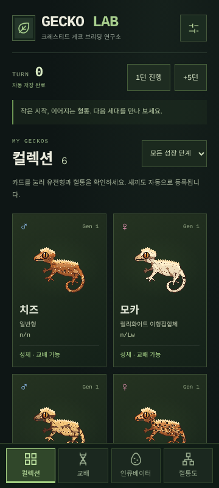
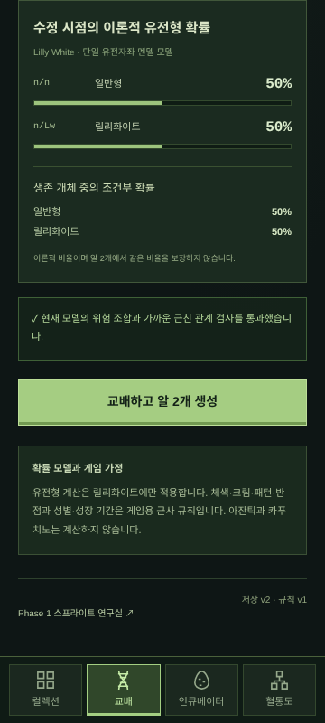
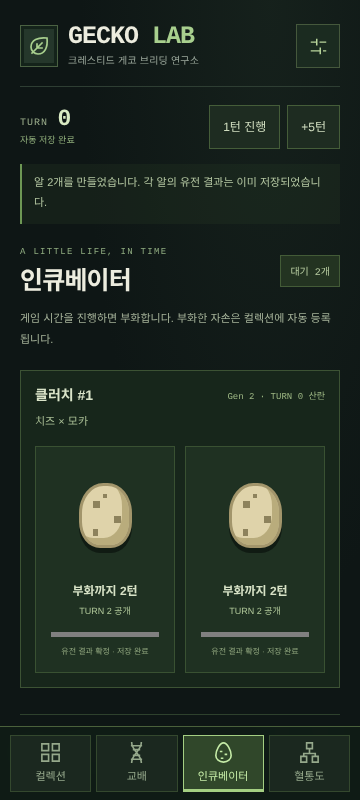
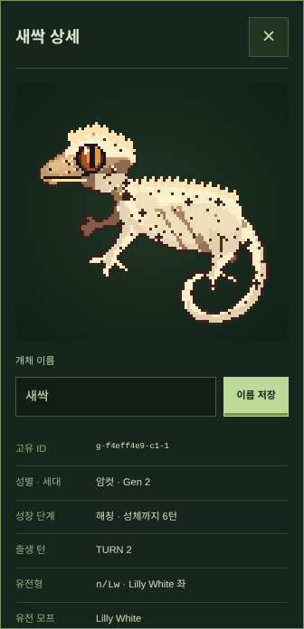
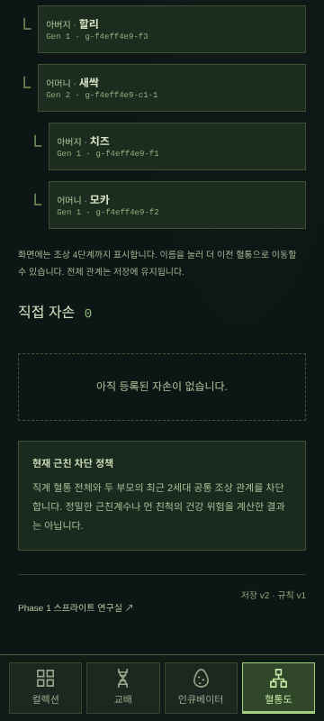

# GECKO LAB — Phase 2: Genetics & Breeding Gameplay

고정 시드 기반 유전 모델과 혈통을 유지하는 **로컬 모바일 브리딩 게임**입니다.
부모 선택 → 확률 확인 → 알 2개 → 부화 → 이름 지정 → 성장 → 다음 세대 교배까지 플레이할 수 있습니다.
게임 진행은 IndexedDB에 자동 저장합니다. 계정·서버·재화·외부 API는 사용하지 않습니다.

## 실행

Node.js 24 LTS 권장(22 이상), npm, IndexedDB와 Canvas 2D를 지원하는 브라우저가 필요합니다.

```sh
cd /workspace/gecko-lab
npm ci
npm run dev
```

일반 로컬 체크아웃에서는 해당 저장소 디렉터리에서 같은 명령을 실행하세요. 개발 기본 포트는 3000입니다.
클라우드 작업은 기존 체크아웃에서 진행하고 사용자가 명시하지 않으면 Git worktree를 만들지 않습니다.
새 브라우저 저장소에서는 명시적인 유전형을 가진 시작 성체 6마리를 제공합니다.
정상 일반형 수컷 **치즈**, 릴리화이트 암컷 **모카**, 추가 실험용 개체 4마리입니다.

```sh
npm run build
npm run start
```

- `/`: 브리딩 게임. 하단 컬렉션·교배·인큐베이터·혈통도 탭.
- `/lab`: 기존 Phase 1 스프라이트 연구실. 렌더러와 6개 기존 E2E 시나리오를 유지합니다.
- 초기 상태는 고정 시드 `GECKO-LAB-START`입니다. 새 게임에서 다른 시드를 입력할 수 있습니다.
- dev 리소스에는 localhost와 로컬 검사에 쓰는 127.0.0.1만 허용합니다. 다른 개발 호스트는 `allowedDevOrigins`에 명시하세요.

## 실제 플레이 순서

1. 하단 **교배**를 열고 수컷 치즈, 암컷 모카를 선택합니다.
2. 수정 시점 일반형 50% / 릴리화이트 50%와 생존 조건부 확률을 확인합니다.
3. **교배하고 알 2개 생성**을 누릅니다. 부모의 대기 기간과 각 알의 독립 결과를 저장합니다.
4. 인큐베이터에서 **1턴 진행**을 두 번 누릅니다. 기본 부화 기간은 2턴입니다.
5. 부화한 자손의 **이름과 상세 정보**를 열고 이름을 저장합니다. 컬렉션에는 자동 등록됩니다.
6. 부화 이후 기본 3턴에 아성체, 6턴에 성체가 됩니다. 상단 `+5턴`으로 시간을 빠르게 진행할 수 있습니다.
7. 성체 자손의 상세에서 **부모로 선택**합니다. 원래 부모 대신 혈연 없는 다른 성체를 선택해 다음 세대를 만듭니다.
8. 혈통도에서 부모·조상을 확인합니다. 조상 이름을 누르면 더 이전 세대로 이동할 수 있습니다.
9. 페이지를 새로고침해도 개체·이름·유전형·알·턴·혈통·재현 정보가 유지됩니다.

성별·성장 단계·교배 대기·건강 위험·혈연 검사 중 하나라도 실패하면 교배를 실행할 수 없습니다.
부모·자손과 형제자매를 포함한 가까운 근친 교배를 차단합니다.
기본 기간과 형질별 변이 폭은 **새 게임 설정**에서 바꿀 수 있으며 기존 개체의 규칙은 중간에 변경하지 않습니다.

## 유전형과 표현형

- **Genotype**: 버전이 있는 유전자좌별 대립유전자 쌍. 현재 Lilly White 좌의 `n/n`, `n/Lw`만 생존 개체로 등록합니다.
- **Potential traits**: 체색·적색·크림·등·측면·반점의 0~1 게임용 잠재 수치.
- **Phenotype / 모프**: 유전형에서 계산한 릴리화이트 여부와 잠재 수치의 외형 분류를 분리합니다.
  할리퀸·반점 외형은 정확한 단일 유전자 확률을 뜻하지 않습니다.
- **Graphics adapter**: 유전 결과와 잠재 수치를 기존 `GeckoSpecimen.appearance`로 변환합니다.
  자손의 세부 무늬는 부모 시드를 복사하지 않고 개체 고유 시드를 사용합니다.

| 부모 | 수정 시점의 이론적 확률 | 생존 조건부 확률 | 실행 |
| --- | --- | --- | --- |
| Normal × Lilly White | Normal 50%, Lilly White 50% | 각각 50% | 다른 제한을 통과하면 가능 |
| Lilly White × Lilly White | Normal 25%, Lilly White 50%, 동형접합 비생존 25% | Normal 33.3%, Lilly White 66.7% | 차단 |

Lilly White 계산은 요청에서 지정한 단일 유전자좌·동형접합 비생존 모델입니다.
분자 유전자 검사나 실제 생존율 예측이라고 주장하지 않습니다.
**다유전자 외형의 부모 평균 ± 변이, 성별 50:50, 부화·성장 기간, 시작 개체의 무혈연은 게임용 가정**입니다.
검토되지 않은 Axanthic·Cappuccino 및 복합 대립유전자 모델은 포함하지 않습니다.
근친 정책은 직계 전체와 양쪽 최근 2세대 공통 조상을 차단하며 정밀한 근친계수는 계산하지 않습니다.
범위와 근거 한계는 [유전 모델 문서](docs/genetics-model.md)에 명시했습니다.

## 저장·백업·복원

설정 버튼에서 **JSON 백업 저장**, **JSON 백업 파일**, **새 게임 설정**을 사용할 수 있습니다.
복원과 새 게임은 기존 슬롯을 교체하기 전에 확인 화면을 거칩니다. 취소하면 기존 진행을 유지합니다.

- 저장 v2 / 게임 규칙 v1 / 유전 모델 v1 / 그래픽 엔진 v1.0.0.
- 자동 저장은 IndexedDB 트랜잭션 완료 후 화면에 반영합니다. 저장 실패 시 해당 행동을 반영하지 않습니다.
- 개체·혈통·유전형·잠재 형질·알 속 확정 결과·성장 상태·턴·게임 시드·다음 클러치 번호를 저장합니다.
- 체크섬과 구조·부모 참조·세대·생존성·형질 범위·알/자손 일치 여부를 검사합니다.
  체크섬은 우발적인 손상 검사용이며 보안 서명은 아닙니다.
- 손상·버전 불일치 저장은 자동 덮어쓰지 않습니다. 명시적으로 정상 백업을 복원하거나 새 게임으로 복구할 수 있습니다.
- 저장 리비전 비교로 오래된 탭의 덮어쓰기를 차단합니다. 해당 탭을 새로고침해 최신 상태를 읽으세요.
- JSON 백업 최대 16MB, 한 저장 슬롯의 개체와 부화 예정 자손 합계 최대 3,000마리입니다.
- 브라우저 데이터 삭제·기기 변경·출처/포트 변경은 별도 저장소가 됩니다. JSON 백업을 별도로 보관하세요.
  브라우저 저장 공간과 IndexedDB 접근이 필요합니다.

## 코드 구조

```text
src/
├── genetics/               DOM·UI·그래픽과 독립적인 멘델/연속 형질 계산
│   ├── mendel.ts           범용 좌별 확률, 생존 조건부 확률, 시드 샘플링
│   ├── traits.ts           게임용 부모 평균과 형질별 변이
│   └── random.ts           버전이 있는 독립 난수 스트림
├── game/
│   ├── model.ts            개체·알·성장·게임 상태 계약
│   ├── play.ts             부모 검사, 알 생성, 시간·부화·성장·이름 변경
│   ├── lineage.ts          조상 탐색과 근친 차단 정책
│   ├── adapter.ts          유전형 → 표현형 → 기존 렌더링 계약
│   ├── validation.ts       구조·혈통·개체/알 데이터 검증
│   └── save.ts             체크섬이 있는 버전 JSON 형식
├── storage/indexed-db.ts   원자 저장, 자동 초기화, 탭 간 덮어쓰기 방지
├── hooks/use-game.ts       저장 완료 후 상태 반영과 행동 중복 방지
├── components/game/        모바일 컬렉션·교배·인큐베이터·혈통·상세·설정
├── engine/                 Phase 1 렌더러 그대로 유지
└── app/                    게임 / 기존 연구실 / PWA 메타데이터
```

원본 `references/`와 `src/engine/`, 기존 엔진 테스트는 변경하지 않았습니다.
기존 브라우저 테스트는 방문 경로만 `/lab`으로 이동했고 테스트를 삭제·비활성화하지 않았습니다.
[Phase 1 기록](docs/phase1.md)과 기존 캡처도 유지합니다.

## 검증

```sh
npm run typecheck
npm test
npm run build
npx playwright install chromium
npm run test:e2e
```

이 클라우드 환경에는 시스템 Chromium이 있어 다음 명령으로 추가 브라우저 다운로드 없이 실행할 수 있습니다.

```sh
PLAYWRIGHT_CHROMIUM_EXECUTABLE_PATH=/usr/bin/chromium npm run test:e2e
```

Playwright는 개발 서버와 분리된 **3100 포트의 프로덕션 서버**를 실행합니다.
모바일 프로젝트는 360×800과 실제 터치 이벤트, 데스크톱은 1280×900을 사용합니다.
단위 검사는 10,000회 시드 교배 시뮬레이션, 5세대 이상 자손의 실제 허용 교배·혈통 저장·복원,
위험/근친/성장 제한, 알 생성 시점과 부화 결과 일치, 복원 후 다음 자손의 재현을 포함합니다.
브라우저 검사는 전체 플레이 흐름, IndexedDB 새로고침, 백업·복원, 손상 복구와 탭 충돌을 검증합니다.
GitHub Actions에서도 타입·단위 검사·빌드·브라우저 검사를 실행합니다.

### 검증 결과 — 2026-10-13

| 검사 | 결과 |
| --- | --- |
| TypeScript | 통과 |
| 단위 테스트 | **50/50 통과** — 기존 Phase 1 23개 포함 |
| 프로덕션 빌드 | 통과 — 게임·연구실·매니페스트 정적 생성 |
| Chromium E2E 전체 | **24/24 통과** — 모바일 12개, 데스크톱 12개; 기존 Phase 1 12개 포함 |
| 플레이 캡처 재검증 | 모바일·데스크톱 전체 플레이 시나리오 2/2 통과 |

시작 개체 6마리에서 실제 허용 조합을 교배해 **창립 세대 이후 자손 5세대 이상(Gen 6 이상)**을 생성하고 전체 혈통을 JSON으로 복원했습니다.
10,000회 시뮬레이션은 릴리 × 릴리의 이론적 25/50/25 분포를 허용 오차 2% 이내로 확인합니다.
이 시뮬레이션은 계산 모델 검증이며 위험 조합을 플레이에서 실행하는 기능이 아닙니다.
실제 모바일 터치로 지정된 13단계 플레이 흐름을 실행했고, 자손을 성장시켜 다음 세대 알·자손을 생성한 뒤 새로고침 데이터 일치를 확인했습니다.
모든 게임 탭에서 가로 넘침과 브라우저 오류가 없고, 주요 탭의 터치 영역이 44px 이상임을 확인했습니다.
손상·미지원 백업의 거부, 손상 IndexedDB의 자동 덮어쓰기 방지와 명시적 복구, 탭 간 저장 충돌도 검사했습니다.
삭제·건너뛰기·비활성화한 기존 테스트는 없습니다. 위 결과는 현재 인스턴스의 로컬 검증이며 GitHub CI는 별도로 확인합니다.

### 실제 360px 플레이 캡처







## 남은 한계와 Phase 3 인터페이스

- 아잔틱·카푸치노·복합 유전, 분자 검사, 정확한 근친계수와 실제 생존율 추정은 미구현입니다.
- 게임 시간과 연속 형질은 생물학적으로 검증된 성장·육종 예측이 아닙니다.
- 혈통도는 화면에 조상 4단계를 표시하고 조상 선택으로 더 이전 세대를 탐색합니다. 저장에는 전체 관계를 유지합니다.
- PWA 매니페스트와 로컬 아이콘은 있습니다. 서비스 워커와 오프라인 재접속, 기기 간 동기화는 미구현입니다.
- Safari/iOS와 실제 스마트폰 기기 검사는 아직 수행하지 않았습니다. 자동 검증 대상은 Chromium입니다.
- 계정·멀티플레이·거래·재화·사육장·먹이·질병·가챠는 이번 범위에서 제외했습니다.
- 새 고품질 게코 아트는 만들지 않았습니다. 코드로 제작한 Phase 1 베이스는 콘셉트아트의 완성도와 차이가 있습니다.

Phase 3 아트는 `game/adapter.ts`의 **`toSpecimen(Individual) → GeckoSpecimen`** 경계와
`engine/model.ts`의 **96×96 `SpriteResult` / 8개 `SpriteLayer` RGBA+알파 마스크 계약**을 사용할 수 있습니다.
유전 계산은 스프라이트를 직접 참조하지 않습니다. `Individual.stage`는 이미 저장되므로
성장 단계별 그림을 이 경계에서 선택할 수 있습니다.
현재 연속 체색·적색은 기존 제한된 팔레트로 양자화합니다. 더 세밀한 체색 표현은 그래픽 계약 확장으로 개선하세요.
그래픽 규칙을 바꾸면 엔진 버전과 시각 회귀 기준을 갱신하고, 유전형·혈통 ID·시드 계약은 유지해야 합니다.

기능 브랜치에서 main 대상 PR로 검토합니다. Phase 1이 main에 병합되기 전에는 Phase 2 PR이 Phase 1 변경도 포함합니다.
