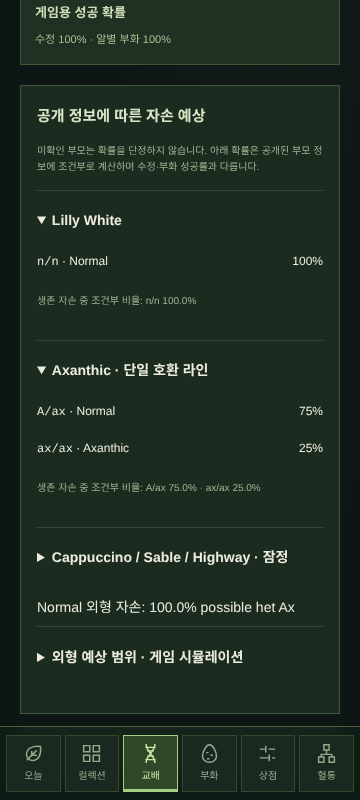
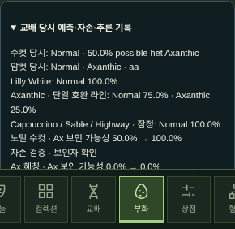
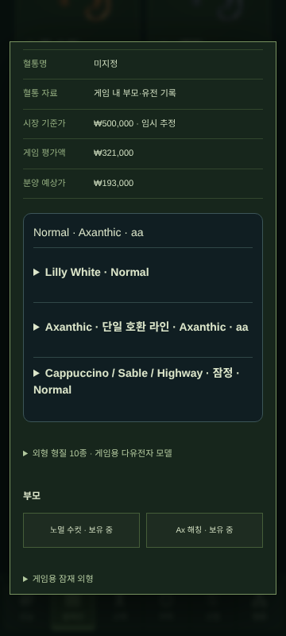
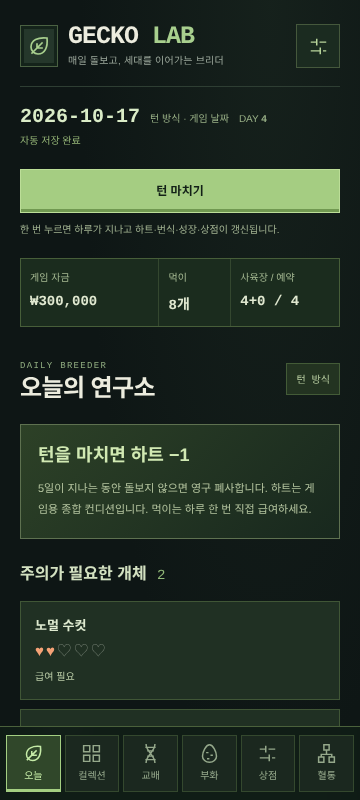
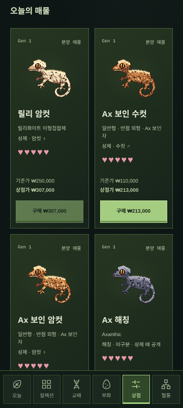
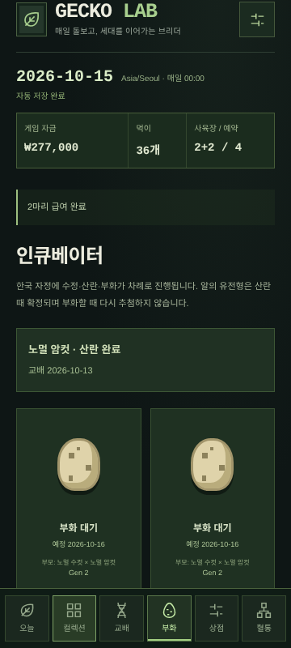
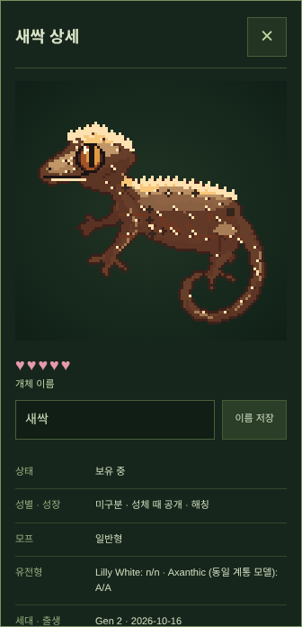
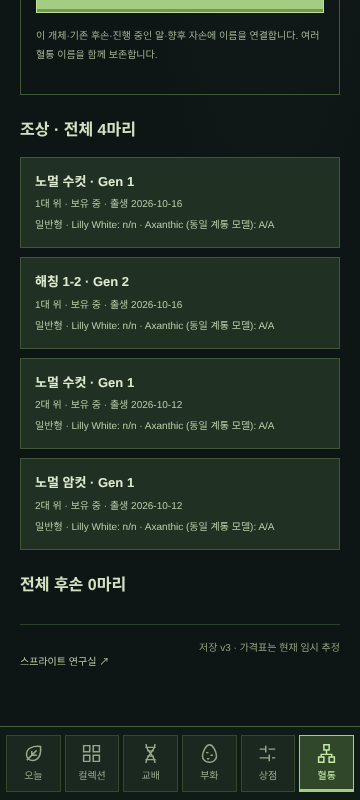
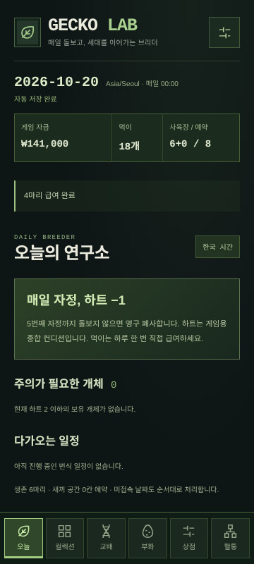

# GECKO LAB — Phase 5: Advanced Genetics Engine

**턴 마치기로 하루씩 진행하거나 한국 자정을 선택해** 개체를 돌보고, 여러 세대의 혈통을 이어가는 로컬 모바일 브리딩 경영 게임입니다. 상점에서 개체와 먹이를 구입하고, 배란기에 교배해 자손을 분양하거나 다음 세대 부모로 남길 수 있습니다. 판매·폐사한 개체도 영구 혈통 기록에 남습니다.

**게임에서 하루가 지나면 하트가 1 줄고, 0이면 영구 폐사합니다. 기본 시간 방식은 턴 마치기이며 자동 급여는 없습니다.** 하트는 게임용 종합 컨디션이며 실제 동물의 생존 기간이나 사육 지침이 아닙니다.


Phase 5는 **실제 대립유전자 → 표현형 → 모프 분류 → 렌더러 입력**과 **플레이어의 공개 유전 지식**을 분리합니다. 신규 개체는 60개 가상 좌위로 외형 10종을 상속하며, 상점의 숨은 아잔틱 보인자는 구매 전에 확정됩니다. Possible het·부화 증거에 따른 베이즈 추론·교배 기록·유전학 도감·세대별 형질 분석을 제공합니다. 저장 v2·v3·v4는 v5로 이전하며 기존 외형과 혈통을 보존합니다.

[유전 모델·출처·한계](docs/genetics-model.md), [100,000회 및 선택교배 원시 결과](docs/genetics-simulation.json)를 확인할 수 있습니다.

## 실행

Node.js 24 LTS 권장, npm, Canvas 2D와 IndexedDB를 지원하는 브라우저를 사용합니다.

```sh
npm ci
npm run dev
```

프로덕션 실행:

```sh
npm run build
npm run start
```

- `/`: 기본 턴 방식 / 선택 가능한 현실 시간 게임. 오늘·컬렉션·교배·부화·상점·혈통 탭.
- `/lab`: Phase 1 스프라이트 연구실. 기존 렌더러·원본 이미지 유지.
- `/lab/breeding`: Phase 2 회귀 검사용 턴 시뮬레이터. 정식 게임과 **별도 저장 슬롯**을 사용합니다. 이전 단계의 테스트 화면을 유지합니다.
- 개발 포트 3000, E2E 전용 프로덕션 포트 3100. 클라우드에서는 기존 체크아웃을 사용합니다.

## 실제 플레이

1. 상점에서 노멀 수컷·암컷과 먹이를 구입합니다. 초기 4칸 중 2칸은 자손을 위해 남깁니다.
2. 교배 화면에서 성체 부모를 선택하고 배란 상태·수정/부화 성공률·좌별 유전형 확률을 확인합니다.
3. 교배 일정 시작 시 새끼 2칸을 예약합니다. 암컷은 회복 기간에 들어갑니다.
4. **턴 마치기**를 누르면 하루가 지나고 수정 결과가 공개됩니다. 실패하면 공간 예약을 해제합니다.
5. 교배 이틀 뒤 성공한 생존 암컷이 알 2개를 산란합니다. 각 알의 유전형·잠재 형질·성별·외형 시드를 이때 확정합니다.
6. 사흘 뒤 알별 부화 성공 여부를 공개합니다. 성공 자손은 하트 5로 컬렉션에 자동 등록합니다. 실패 알은 기록을 남기고 공간을 해제합니다.
7. 해칭 상세에서 이름을 지정합니다. 성별은 성체가 될 때까지 화면에서 숨깁니다.
8. 기본 일정은 나흘 뒤 성체입니다. 혈연 없는 성체와 다시 교배할 수 있습니다.
9. 매일 컬렉션에서 개별 급여 또는 **수동 전체 급여**를 누릅니다. 하트 5 미만일 때 하루 한 번, 재고 1개를 사용해 하트 1을 회복합니다. 재고가 부족하면 하트가 적은 개체부터 가능한 수만 먹입니다.
10. 상세에서 기준가·평가액·분양 예상가를 확인하고 분양을 확정합니다. 자금은 증가하고 개체는 사육장에서 나가지만 기록은 유지됩니다. 산란 전 일정이 있는 암컷은 분양할 수 없습니다.
11. 상점에서 사육장을 확장하고 우수한 자손을 다음 세대 부모로 남깁니다.
12. 혈통도에서 혈통 이름을 등록하고 모든 조상·후손·판매·폐사를 탐색합니다. 혈통 이름은 유전형이나 외형/가격 점수를 높이지 않습니다.

상단 **턴 마치기**는 정확히 하루를 진행합니다. 실제 시간이 지나거나 새로고침해도 턴 방식에서는 날짜·하트·알이 진행되지 않습니다. 설정의 **시간 진행 방식**에서 **한국 자정**을 선택하고 **시간 방식 저장**을 누르면 기존 현실 시간 방식을 사용할 수 있습니다. 새 게임에서도 시간 방식을 선택할 수 있습니다.

| 방식 | 하루가 진행되는 시점 | 미접속 처리 |
| --- | --- | --- |
| 턴 마치기 (기본값) | 버튼 한 번당 게임 하루 | 추가 날짜 처리 없음 |
| 한국 자정 | Asia/Seoul의 날짜가 바뀔 때 | 누락한 현실 날짜를 순서대로 처리 |

시간 방식만 `time-source.ts`에서 교체합니다. 하트·급여 제한·배란·수정·산란·부화·성장·재고는 두 방식 모두 같은 `calendar.ts` 일일 처리 로직을 사용합니다. 모드 전환은 게임 날짜·진행·하트·알을 앞당기거나 되돌리지 않습니다. 현실 시간으로 전환한 한국 날짜를 별도 앵커로 저장하고, 다음 자정부터 논리 게임 날짜를 하루씩 증가시킵니다. 수동 턴으로 게임 날짜가 현실보다 앞서 있어도 다음 자정에 정상 진행됩니다.

현실 시간 방식은 재접속·화면 복귀·행동 전, 또는 열린 화면의 30초 간격 확인으로 동기화합니다. 저장 중 날짜 변경 신호가 도착해도 저장 후 현재 시계를 재확인해 빠진 날짜를 처리하고 사용자 행동은 재실행하지 않습니다. 기기 시간 조작을 막지 않으며 이미 처리한 현실 날짜를 반복하거나 과거로 되돌려도 진행과 폐사는 되돌리지 않습니다.

## 일일 순서와 밸런스

기존 생존 개체 하트 감소 → 폐사 확정 → 수정/산란 일정 → 알 부화 → 생존 개체 성장 → 계산된 배란 상태 → 상점 재고 갱신 → 원자 저장 순서입니다. 당일 부화한 새끼는 하트를 즉시 잃지 않습니다. 산란 전에 암컷이 폐사하면 일정을 취소합니다. 이미 산란한 알은 부모 폐사 후에도 부화를 계속합니다.

설정은 [balance.ts](src/game/hardcore/balance.ts)의 버전 관리 데이터이며 새 게임에 복사해 저장합니다. 현재 게임의 규칙을 배포만으로 변경하지 않습니다. 날짜·규칙·시드를 주입해 자동화 테스트할 수 있습니다.

| 항목 | 기본값 |
| --- | --- |
| 초기 자금 / 사육장 | ₩500,000 / 4칸, 시작 개체·먹이 없음 |
| 하트 / 하루 진행 시 감소 / 급여 | 5 / −1 / +1, 하루 개체당 1회 |
| 배란 주기 / 배란 창 / 회복 | 6일 / 2일 / 4일 |
| 수정 성공 / 알별 부화 성공 | 90% / 90%, 독립 게임 확률 |
| 교배 → 수정 / 산란 / 부화 | +1일 / +2일 / +3일 |
| 성체 나이 | 부화 후 1일 (Day 4) |
| 성장 단계 | 해칭·아성체·성체. 기본 압축 일정은 아성체 기간을 건너뜀; 성체 기간을 2일 이상 설정하면 아성체 단계 유지 가능 |
| 먹이 단가 | ₩1,000, 1회 구매 1~1,000개 |
| 사육장 확장 | +4칸, ₩100,000 × (확장 횟수+1), 최대 3,000칸 |
| 상점 / 즉시 분양 | 게임 평가액 × 1.15 / × 0.60, 천원 단위 반올림 |
| 신규 외형 유전 | 60개 가상 이배체 좌위 · 10종 점수 · 돌연변이 꺼짐 |
| 이전 외형 모델 | 체색 ±.12, 적색 ±.10, 크림 ±.12, 등 ±.10, 측면 ±.12, 반점 ±.16 유지 |

일정·하트·성별 50:50·압축 성장·연속 외형 변이는 현실 생물학의 검증된 수치가 아닌 게임 가정입니다.

## 유전과 외형

| 좌위 | 방식·범위 | 근거·안전 |
| --- | --- | --- |
| Lilly White | n/n, n/Lw, Lw/Lw · 불완전 우성 | 브리더 관찰 · Lilly끼리 교배 차단 · 수정 비생존과 생존 조건부 확률 구분 |
| Axanthic | AA, Aa, aa · 한 호환 라인의 열성 모델 | 브리더 관찰 · 라인 간 호환성은 미확정 |
| Cappuccino/Sable/Highway | n/C/S/H · 다중 대립유전자 잠정 좌위 | FG PSA v1.2 (2026-09-08) · Super/Luwak/Sorak 등 위험 차단, 정확한 사망률 없음 |

2026-10-13 Corch Geckos, IB EXOTIC, Foundation Genetics PSA, Gecktopia 근거 설명을 직접 열람했습니다. DNA 수준의 확정 모델로 주장하지 않습니다. 좌위별 출처·검토일·근거 수준·이견·안전 정책을 데이터로 관리합니다. 범용 엔진은 독립 좌위의 모든 유전형 조합과 표현형별 합산, 용량 효과, 조합명(Frappuccino/Sorak)을 지원합니다. 연관 좌위는 지원 인터페이스만 있으며 몰래 독립 계산하지 않고 거부합니다.

C/S/H는 계산기·유전체·상속·안전 엔진에서 지원합니다. 현재 상점에는 Lilly·Normal·Ax 라인만 생성하며 C/S/H 신규 매물과 전용 가격은 넣지 않습니다. 가격표를 임의로 바꾸지 않았습니다.

### 숨은 보인자와 지식

상점 노멀 수컷은 판매자 부모 기록 Aa×AA에 따른 50% possible het, 실험용 암컷은 Aa×Aa의 Normal 자손에 따른 66.7% possible het을 표시합니다. 내부 실제 유전형은 매물 생성 순간 고정되고 구매·교배 결과로 바뀌지 않습니다. 확정 보인자와 외형 aa 매물도 제공합니다. 판매자 제공 정보는 게임 내 부모 ID로 입증된 혈통과 구분합니다.

교배 화면은 숨은 진실을 조회하지 않고 공개 사전확률을 결합합니다. 부화한 자손 외형만으로 부모의 아잔틱 확률을 베이즈 갱신하며 미부화/실패 알은 관찰에서 제외합니다. aa 자손은 열성 사본을 확인하지만 Normal 자손 몇 마리로 비보인자로 확정하지 않습니다. 한 클러치의 두 부모 잠재 상태를 함께 열거하므로 형제 관찰의 공유 부모를 반영합니다. 서로 다른 가족 간에는 현재 주변확률을 전달하는 근사이며 전체 혈통의 정확한 베이즈 네트워크를 구현했다고 주장하지 않습니다.

상세·혈통·매물은 공개 지식만 표시합니다. 교배 당시 부모 정보·예상 확률·자손 결과·추론 전후를 인큐베이터 기록에서 펼쳐 볼 수 있습니다. 원본 유전체는 로컬 백업에 보존되므로 파일 검사까지 막는 안티치트는 없습니다.

### 가상 다유전자와 렌더링

붉은 발색, 노랑·오렌지, 명도, 크림 면적, 등/옆구리, 할리퀸, 반점, 핀스트라이프, 대비에 각각 6개 가상 좌위를 둡니다. 자손은 각 좌위에서 부모 대립유전자를 하나씩 상속합니다. 외형 수치 평균이나 세대 보너스로 새 점수를 만들지 않습니다. 일부 효과 공유는 **명시적 게임 모델**이며 원인 유전자·염색체가 발견되었다는 의미가 아닙니다. 가산 효과·설정된 우성 효과·공유 효과·파이어 상태를 분리하고 기본 돌연변이는 꺼져 있습니다. 선택교배는 유전 다양성을 줄일 수도 있습니다.

96×96 렌더러·8개 레이어·기존 픽셀 검사와 레퍼런스는 유지합니다. 새 표현형을 기존 팔레트·등/측면 면적·반점 수로 양자화하며 핀스트라이프/대비는 현재 등/측면 입력에 근사 반영합니다. 전용 핀스트라이프·다리 무늬·연속 팔레트·C/S/H 아트와 성장별 그림은 향후 작업입니다. 외형 시드는 유전자와 별개이며 부모 시드를 복사하지 않습니다. 파이어 미리 보기는 유전형이나 저장 진행을 바꾸지 않습니다. 코드 베이스를 콘셉트아트와 같은 품질이라고 주장하지 않습니다.

## 가격 데이터와 조사 한계

**현재 가격표의 모든 항목은 임시 게임 가격이며 국내 검증 시세가 아닙니다.** 2026-10-13 공개 사이트 접근 시도는 환경 프록시에서 403으로 거부되어 유효 매물·실거래 표본은 0개입니다. 희망가 범위·중앙값·낙찰가를 확보했다고 주장하지 않습니다. 접근 제한을 우회하지 않았습니다.

- [market/prices.json](market/prices.json): 버전·적용 날짜·기준가·매입/매도 배율.
- [market/sources.json](market/sources.json): 조사 날짜·출처·표본 수·신뢰도·실패와 미확인 기록.
- [수동 시세 업데이트 절차](docs/market-update.md): 주 1회 목표, 중복·이상치·희망가/실거래 구분, 사람 검토·승인 후 PR 반영 및 Vercel 배포.
- [market/history](market/history/README.md): 이전 가격표와 출처 보관 규칙.

개별 평가는 보이는 모프·외형·공개 성별·성장·확인된/possible het·정보 출처·부모 기록을 반영합니다. 숨은 Aa와 AA가 같은 외형·공개 증거를 갖는다면 가격도 같습니다. Possible het은 정당한 확률과 판매자 정보 신뢰 보정으로 평가하며 미확인 유전형은 프리미엄을 받지 않습니다. 유전자 가격을 단순 합산하지 않습니다. 같은 모프에서도 가격이 다르며 현재 보정값과 복합 모프 가격도 게임 추정입니다. 시장 기준가·개별 평가액·플레이어 즉시 분양가를 구분합니다. 같은 날 매입 후 즉시 재판매하면 손실이 발생합니다.

새 가격표는 현재 매물과 향후 견적에 적용합니다. 이미 완료된 판매는 당시 날짜·금액·기준가·평가액·가격표 버전을 유지합니다. 앱에는 자동 수집 봇, 관리자 서버 또는 외부 API가 없습니다.

## 저장·이전·아카이브·오프라인

정식 슬롯은 IndexedDB `gecko-lab / games / active`, Phase 2 실험 슬롯은 `phase2-lab`입니다. 저장 형식 v5 / 규칙 v2를 사용하며 날짜·자금·먹이·용량·예약 일정·하트·유전형·외형 시드·알·판매·혈통·시장 버전·다음 교배 번호를 보존합니다. 알 결과와 번식 성공률 스냅샷을 저장하므로 새로고침이 재추첨을 일으키지 않습니다.

- 저장 트랜잭션이 완료된 후 행동을 화면에 반영합니다. 저장 실패는 해당 행동을 반영하지 않습니다.
- 리비전 비교로 오래된 탭의 덮어쓰기를 차단합니다. 충돌 창은 새로고침해야 합니다.
- 체크섬과 구조·날짜·유전형·혈통·알/자손·예약 공간을 검사합니다. 체크섬은 손상 검사이며 보안 서명이 아닙니다.
- 기존 active v2 데이터와 JSON v2 백업은 자동 이전합니다. ID·이름·부모·세대·잠재 형질·시드·다음 클러치를 유지합니다. 기존 성장 기간을 보존하고 남은 알 일정은 날짜로 옮깁니다. 기존 알은 새 실패 확률 없이 부화합니다. 기존 개체는 하트 5, 기존 살아 있는 개체와 알이 모두 들어가는 용량으로 이전합니다.
- Phase 2에는 현실 시간 앵커가 없으므로 이전하는 오늘을 관리 시작일로 합니다. 과거 미접속을 임의로 만들어 폐사시키지 않습니다. 원본 v2도 아카이브에 보관합니다.
- 기존 v3 저장/백업은 시간 방식 필드와 유전 정보 출처를 추가한 v5의 기본 턴 방식으로 이전합니다. 저장된 게임 날짜·하트·알·유전형·혈통·시드·교배 번호·경제·판매 이력을 그대로 유지하고, 이전 당시 추가 현실 날짜를 적용하지 않습니다. 원본 active v3도 같은 트랜잭션에서 아카이브에 보관합니다.
- v4·v5 백업은 시간 방식과 현실 날짜 앵커까지 유지합니다. 복원 시 턴 방식은 멈춘 날짜를 유지하고, 현실 시간 방식은 앵커 이후 누락 날짜를 처리합니다. 손상·미지원 저장을 자동 덮어쓰지 않고 명시적인 복구 확인을 요구합니다.
- v2·v3·v4의 숫자 외형에서 가상 대립유전자를 만들어내지 않습니다. 기존 명시 좌위는 이전 기록으로 유지하고, 누락 Ax/복합 좌위는 미확인입니다. 가상 유전체는 null이며 기존 수치·픽셀·이미 결정된 알 결과를 보존합니다. 이 개체와의 교배는 이전 평균·변이 모델로 표시하며 불확실성을 계속 보존합니다. 원본 active v4도 같은 트랜잭션에서 아카이브에 남깁니다.
- 새 게임/복원은 이전 슬롯을 동일 트랜잭션에서 아카이브에 남깁니다. 아카이브는 조회·JSON 다운로드할 수 있으며 새 게임의 개체와 합치지 않습니다. JSON 복원은 수동 백업 기능으로 로컬 시간·백업 조작을 방지하는 안티치트는 없습니다.
- 프로덕션 서비스 워커는 한 번 온라인으로 로드한 정식 화면과 정적 번들을 캐시합니다. HTTPS 또는 localhost에서 오프라인 새로고침을 지원합니다. **급여·보호를 실행하지 않으며**, 오프라인에서도 저장된 시간 방식에 따라 하루를 처리합니다. 캐시가 준비되기 전 최초 방문은 네트워크가 필요합니다.
- 브라우저 저장소 삭제·기기/출처 변경은 별도 상태입니다. JSON 백업을 보관하세요. 백업 최대 16MB, 슬롯 내 개체 기록 30,000개, 알 기록 60,000개, 생존 용량 최대 3,000칸입니다. 판매·폐사를 이유로 기록을 삭제하지 않습니다.

## 구조와 아트 확장 인터페이스

```text
market/                       버전 가격표·출처·이력
src/genetics/advanced/         좌위·근거 / 상속·생식세포 / 다유전자 / 표현형·모프 / 추론 / 시뮬레이션
src/genetics/hardcore.ts       기존 Lilly + Ax 캐시 계약 유지
src/game/hardcore/
  time.ts / calendar.ts       한국 날짜와 결정적 일일 처리
  time-source.ts              턴/현실 날짜 선택, 모드 전환, 공통 일일 처리 연결
  model.ts / balance.ts       저장 v5·규칙 v2·시간 방식·게임 설정
  survival.ts / breeding.ts   하트·급여·폐사·배란·수정·알·부화
  economy.ts / shop.ts        구매·분양·공간·결정적 실제 매물
  market.ts / lineage.ts      기준가/견적·영구 조상/후손·혈통 이름
  create.ts / save.ts         v2/v3/v4 이전·체크섬·JSON 백업
  genetics.ts                게임 연결·공개 예측·자손 관찰·교배 기록
  validation.ts / legacy-validation.ts / play.ts  신규 유전체·이전 계약 검증·행동 reducer
  adapter.ts                 유전형/잠재 형질 → 기존 GeckoSpecimen
src/storage/hardcore.ts       원자 저장·이전·CAS·이전 게임 아카이브
src/hooks/use-hardcore.ts     주입 가능한 시계, 저장 후 UI 반영
src/components/hardcore/      모바일 여섯 화면·상세·복원
public/sw.js                  오프라인 화면 캐시
src/engine/                   Phase 1 렌더러 변경 없음
```

향후 아트 개선은 `hardcore/adapter.ts`의 `specimen(Gecko) → GeckoSpecimen`, `engine/model.ts`의 96×96 `SpriteResult` / 8개 `SpriteLayer` RGBA+알파 마스크 경계를 사용합니다. 성장 단계는 `Gecko.stage`, 하트·생존은 게임 데이터에서 읽고 유전 계산에는 그래픽 의존성을 추가하지 않습니다. 유전형·부모 ID·고유 시드의 계약을 유지하면서 아트 버전과 시각 회귀 기준을 따로 갱신하세요.

## 검증

```sh
npm run typecheck
npm test
node scripts/genetics-report.mjs > /tmp/gecko-genetics-report.json
npm run build
PLAYWRIGHT_CHROMIUM_EXECUTABLE_PATH=/usr/bin/chromium npm run test:e2e
```

다른 환경에서 Playwright 브라우저가 없으면 `npx playwright install chromium`을 실행합니다. 모바일은 360×800의 실제 터치 조작, 데스크톱은 1280×900입니다. E2E는 실제 턴 마치기 버튼과 주입한 가상 기기 시계로 각각 두 방식을 검사합니다. 프로덕션 3100 포트를 사용합니다.

검사 범위: 기존 Phase 1~3와 시간 방식 테스트를 삭제·건너뛰지 않습니다. v3 이전 테스트는 실제 구버전 필드와 v5 목적 버전에 맞게 갱신했습니다. 유전 모델 9개, 게임 연결 9개 검사를 추가하고 기존 10세대 검사와 별도로 **자손 20세대(Gen 21)**를 실제 일일 reducer·급여·무혈연 교배·판매·폐사·매 세대 백업 복원으로 생성합니다.

### 로컬 검증 결과 — 2026-10-13

| 검사 | 결과 |
| --- | --- |
| TypeScript | 통과 |
| 단위 검사 | **99/99 통과** — 기존 81개 + 유전 9개 + 게임 9개 |
| 프로덕션 빌드 | 통과 — 정식 게임·두 연구실·매니페스트 정적 생성 |
| Chromium E2E | **54/54 통과** — 기존 48개 + 신규 360×800/데스크톱 각각 3개; 가로 넘침·페이지/콘솔 오류 없음 |
| 실제 혈통 검사 | 자손 20세대 **Gen 21**, 모든 가상/멘델 좌위·알·판매/폐사 조상·복원 검사 |
| 100,000회 Ax 시뮬레이션 | AA 25.057% / Aa 50.044% / aa 24.899%, 모두 이론값 5σ 범위 안 |
| 선택교배 3집단 / 20세대 | 붉은 발색 약 35→88점, 무선별 대조군 33~36점, 유전 다양성 감소 확인 |

재현 명령은 위 `genetics-report.mjs`이며 [원시 결과](docs/genetics-simulation.json)에 고정 시드·세대별 평균·다양성·표본 수·표준화 오차를 기록했습니다. 집단 실험은 현실 육종 예측이나 게임 내 근친 교배 허가가 아닙니다.

Node/Chromium 간 소수점 차이로 정상 JSON이 거부되는 문제를 브라우저에서 발견하고 외형 검증 오차 1e-12를 허용했습니다. 대립유전자·시드·부모·알 기록의 비교는 엄격하게 유지하고 실질적인 점수 변경은 거부합니다. 전체 E2E의 기존 회귀와 신규 터치 흐름을 함께 실행합니다.

### 실제 모바일 캡처





Phase 5 캡처는 자동화 브라우저의 실제 화면입니다. 검증용 JSON은 초기 자금 200만원·수정/부화 100% 설정으로 결과 경로를 고정했으며 일반 새 게임은 기존 50만원·90%/90% 규칙을 유지합니다. 아래 Phase 3 캡처는 이전 버전 기록입니다.










모달 캡처는 336×696, 나머지는 360×800 브라우저 원본이며 이미지 편집은 하지 않았습니다.

## 남은 한계

- 실제 국내 시세·거래 자료가 미확보이며 경제 밸런스는 플레이테스트와 사람의 가격 검토가 필요합니다.
- 동일 계통 Ax 열성·Lilly 불완전 우성은 브리더 관찰 작업 모델이며 DNA 확정이 아닙니다. 계통 간 호환성과 복합 좌위는 잠정입니다.
- 추론은 한 가족의 작은 상태 공간에서 정확하며 여러 가족/깊은 혈통의 상관관계는 주변확률 근사입니다.
- 이전 숫자 형질은 가상 대립유전자로 복원할 수 없습니다. 신규×신규에만 60좌위 상속을 적용합니다.
- C/S/H는 계산·상속·안전 지원 범위이며 신규 매물·전용 가격·아트는 미제공입니다. 실제 연관 유전·돌연변이·유전자 검사 서비스는 미구현입니다.
- 그래픽 품질·성장별 스프라이트·애니메이션은 개선하지 않았습니다.
- 실제 iOS/Safari 기기 검증, 계정·기기 간 동기화, 질병·치료·온습도·청소·멀티플레이는 미구현입니다.
- 자동 급여·예약 급여는 제공하지 않습니다. 현실 시간 방식에는 장기 미접속 보호가 없으며 턴 방식의 미접속은 게임 날짜를 진행하지 않습니다.

[Phase 1 기록](docs/phase1.md), [Phase 2 기록](docs/phase2.md), [유전 모델](docs/genetics-model.md)을 보관합니다. Phase 1~3와 시간 방식 변경은 PR #2로 main에 병합되었습니다. Phase 5는 별도 기능 브랜치에서 검토합니다.
