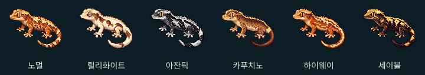
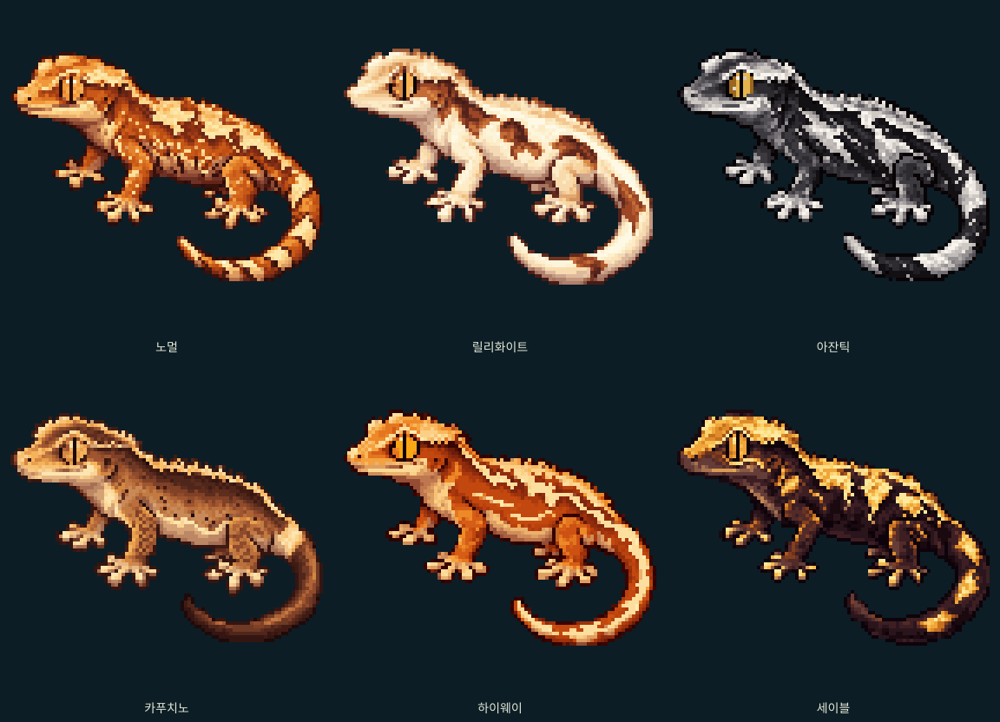

# B · 모프별 독립 PNG 아트 6종

비교 화면: `/lab/appearance/b-breeding/morph-art`

이번 결과는 **고정 아트 자산**이다. 유전체를 읽거나 기존 렌더러의 출력을 가공하지 않는다. 정식 게임, 교배, 저장, 가격, 도전 판정에는 연결하지 않았다. 이전 B 원본과 패턴군 실험도 보존했다.

## 제작 방식과 한계

최초 B의 확대 이미지 `docs/b-original-review/B-original-4x.png`를 형태·표정·픽셀 스타일의 참고로 사용했다. 이미지 생성 도구로 각 모프를 **별개의 요청**으로 제작하고, 몸통·꼬리 무늬를 서로 다르게 지시했다. 초기 6종 동시 생성은 같은 측면 무늬가 반복되어 채택하지 않았다.

채택한 생성 시안은 `sources/`에 그대로 보존했다. 이 원본은 1254×1254의 확대 시안이며, **처음부터 96×96에서 모든 픽셀을 수작업으로 찍은 원화는 아니다**. `scripts/export-b-morph-art.mjs`가 불투명 영역을 잘라 비율을 유지하며 최근접 샘플링하고, 이진 알파·최대 32개 불투명 색상으로 정리한다. 최종 사용·비교 자산은 `public/lab/b-morph-art/`의 96×96 PNG다. 이미지 확대에도 최근접 보간만 사용한다.

따라서 이번 결과를 순수 수작업 원화 6점의 완성과 동일하게 설명하지 않는다. 원본 B와 자세·얼굴 방향은 공유하지만 눈·발가락·꼬리의 픽셀 위치가 완전히 일치하지는 않는다. 엄밀한 공통 실루엣과 전 픽셀 수작업 마감이 필요하다면 아티스트의 추가 정리가 남는다. 생성 시안의 질감을 제한 팔레트로 줄였으므로 노멀의 작은 무늬와 카푸치노의 미세 질감은 실제 96픽셀 화면에서 취향 평가가 필요하다.

PNG를 직접 수정한 후에는 준비 스크립트를 무조건 재실행하지 않는다. `node scripts/export-b-morph-art.mjs --check`는 원본과 내보낸 결과의 일치 여부만 점검한다. 이 검사는 아트 품질을 평가하지 않는다.

## 각 그림의 아트 방향

|모프|새로 구성한 패턴|육안 검토 포인트|
|---|---|---|
|노멀|큰 불규칙 등 섬과 작은 크림 조각, 하부의 어두운 틈, 비대칭 꼬리 무늬|복잡한 크림 무늬와 따뜻한 체색의 균형|
|릴리화이트|연결된 아이보리 바탕, 상부의 갈색 섬, 흰 얼굴·사지·꼬리|넓은 백색 안의 턱·배·무릎 명암|
|아잔틱|검은 바탕을 가르는 은색 사선·번개형 섬, 굵게 끊기는 꼬리 무늬|노멀과 다른 패턴 윤곽 및 흑백 대비|
|카푸치노|짙은 등, 절제된 측면 띠·작은 반점, 밝은 꼬리 기부와 짙은 끝|낮은 패턴 밀도에서도 목·다리·꼬리 입체감|
|하이웨이|안쪽으로 확장되는 연결된 등무늬, 가는 측면 선, 꼬리를 따라가는 밝은 길|등 중심의 길고 연결된 흐름|
|세이블|밝은 크라운, 어두운 바탕 위에 분리된 상부 군집과 꼬리 섬|카푸치노의 절제된 띠와 다른 밝은 군집 구성|

각 그림은 게코랩의 **미적 목표 시안**이다. 모프의 유전적 정의, 업계의 유일한 이상형, 실제 특정 혈통의 재현을 뜻하지 않는다. 카푸치노·하이웨이·세이블은 알려진 외형의 감상 포인트를 참고한 게임 아트 해석이며, 별도 유전 규칙을 확정하지 않는다.

## 자산

- [노멀](../../public/lab/b-morph-art/normal.png)
- [릴리화이트](../../public/lab/b-morph-art/lilly.png)
- [아잔틱](../../public/lab/b-morph-art/axanthic.png)
- [카푸치노](../../public/lab/b-morph-art/cappuccino.png)
- [하이웨이](../../public/lab/b-morph-art/highway.png)
- [세이블](../../public/lab/b-morph-art/sable.png)
- `contact-native.png`: 원본 96픽셀 비교
- `contact-4x.png`: 같은 PNG의 4배 확대 비교
- `export.json`: 제작 시안 크기와 내보내기 영역 기록

비교 화면에는 96×96, 3배 확대, 컬렉션 3열 및 상점 2열의 표시 크기를 제공한다. 카드 비교는 정식 UI의 크기·배경을 참고한 정적 목업이며, 가짜 개체·가격·게임 상태를 만들지 않는다. 각 그림을 누르면 개별 PNG를 열고, 하단 링크로 다운로드할 수 있다.

## 검증

크기·알파·화면 동작 검사는 자산의 기술적 조건을 확인할 뿐, 그림이 아름답다는 근거로 사용하지 않는다.

- 최종 6개 PNG: 모두 96×96, 알파 0 또는 255, 무디더링. 불투명 팔레트는 노멀 30색, 릴리 31색, 아잔틱 19색, 카푸치노 26색, 하이웨이 30색, 세이블 22색이다.
- 원본 크기 및 4배 비교 시트를 직접 열어 보고, 실제 Chromium의 390px·1280px 비교 화면을 캡처해 확인했다. 최초 카드 캡처에서 오른쪽 꼬리가 잘리는 것을 발견해 이미지 너비를 카드에 맞추도록 수정했다.
- `browser-390.png`, `browser-desktop.png`, `cards-390.png`, `shop-390.png`: 실제 브라우저 캡처. 카드 너비 수정 후 320·360·390·430·1280px를 확인했고, 최종 프로덕션 빌드에서 390px·1280px 캡처를 다시 촬영했다.
- 정식 엔진·유전·게임·저장·컴포넌트 및 최초 B 원본 PNG에 변경이 없음을 Git diff로 확인했다.
- 타입 검사·빌드·기존 단위 테스트 432개 통과. 전체 브라우저 회귀 검사 330개 통과(13.6분). 카드 너비 최종 수정이 포함된 빌드에서 새 비교 화면의 모바일·데스크톱 검사 2개도 다시 통과했다.
- PR 자동 검증 첫 실행은 기존 `tests/inherited-patterns.test.ts:94`의 18턴 통합 검사가 5초를 초과해 실패했다(431개 통과, 1개 시간 초과). 같은 검사는 로컬 전체 실행과 별도 단독 실행(3.28초)에서 통과했다. 이번 아트는 해당 게임 모듈에 import되지 않는다. 기존 테스트의 검증 조건이나 시간 제한을 바꾸지 않았으며 문서·최종 캡처 갱신 커밋으로 CI를 다시 실행한다. CI 결과와 로컬 통과 결과를 구분한다.

생성 도구의 확대 원화를 제한 팔레트로 축소했기 때문에 96픽셀에서 작은 무늬 일부가 생략되었다. 모프별 아트 방향이 사용자의 취향에 맞는지, 특히 복잡한 노멀·절제된 카푸치노가 충분히 매력적인지는 이 화면의 실제 그림으로 판단해야 한다.

중단한 이상형 역산 엔진 실험은 `feat/b-ideal-appearance`의 `54e4d71`에 별도로 보존했다. 이번 아트 자산 브랜치는 그 엔진 실험 이전의 `8cd01e6`에서 분기했다.
