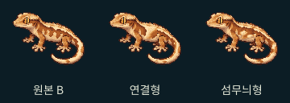
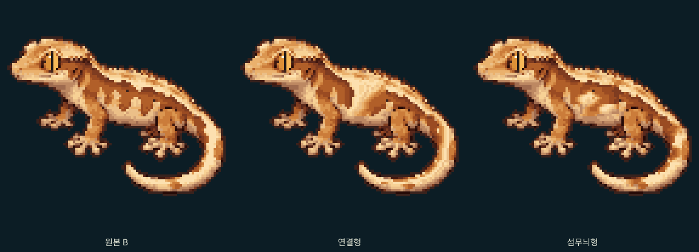

# 최초 B · 노멀 네이티브 픽셀아트 3종

비교 화면: `/lab/appearance/b-breeding/normal-trio`

## 이번 제작 방식

최초 B를 그대로 첫 번째 아트로 보존하고, 두 번째와 세 번째는 **원본의 96×96 픽셀 좌표를 직접 편집**했다. 새 이미지 생성, 확대 원화 축소, 랜덤 노이즈, 절차적 무늬, 기존 패턴군 조합, 유전 점수 기반 변형을 사용하지 않았다.

`pixel-edits.json`의 각 행은 `[y, 시작 x, 팔레트 번호 문자열]`이다. 문자열 한 글자가 네이티브 픽셀 하나이며 `.`은 원본을 유지한다. 공백은 편집 가독성을 위한 구분이다. 모든 패턴 윤곽과 내부 명암은 여기에 명시적으로 배치했다. 출력 스크립트는 이 좌표를 PNG에 기록할 뿐, 새 무늬나 명암을 계산하지 않는다.

원본은 `c9cb231db4afacaffc52b6e9655d57bc9f5a6f26`의 `public/lab/base-study/B-normal.png`다. `B-original-reference.png`에 그 바이트를 보관했다. 이전 실험의 원본 아트와 코드는 기존 브랜치에 보존했다. 이번 변경은 `main`에서 분기한 독립 아트 검토이며, 이전 실험 엔진이나 미승인 모프 아트를 함께 통합하지 않는다.

## 세 타입

|타입|직접 설계한 무늬 구조|작은 카드에서 볼 부분|
|---|---|---|
|원본 B|최초 등·옆구리·꼬리 무늬를 그대로 보존|기존의 갈라지는 불꽃과 크림색 하부 연결|
|연결형|굵은 등무늬에서 옆구리로 내려오는 사선 연결, 꼬리를 따라 길게 이어지는 밝은 선|옆구리의 굵은 크림 연결과 꼬리의 세로 흐름|
|섬무늬형|옆구리에 서로 떨어진 큰 크림 무늬를 엇갈려 배치하고 꼬리에 불규칙한 가로 띠 구성|분리된 옆구리 무늬와 끊어지는 꼬리 리듬|

이 이름은 비교용 디자인 명칭이다. 새로운 유전 모프나 브리더 통용 분류를 뜻하지 않는다. 같은 체색과 팔레트를 사용해 색 변화가 아니라 패턴 구조의 차이를 비교한다.

## 고정한 부분

- 원본 B PNG는 바이트 단위로 그대로 제공한다.
- 세 이미지 모두 같은 96×96 캔버스와 같은 실루엣·투명 영역을 사용한다.
- 얼굴·눈·입·표정은 원본 픽셀을 유지한다. `x ≤ 35` 및 `y ≤ 28`은 편집하지 않는다.
- 원본의 외곽 픽셀, 가장 짙은 구조선, 앞다리·뒷다리 영역, 배 밑의 그림자 띠를 유지한다.
- 몸통과 꼬리 내부에서 피부색과 크림색 무늬를 직접 다시 배치한다. 새 무늬 안의 명암도 같은 원본 팔레트의 밝은색·중간색·그림자색으로 직접 찍었다.
- 짙은 픽셀을 모두 구조선으로 취급하지는 않는다. 등무늬 내부의 단독 점 `(52,37)`은 위치와 주변 픽셀을 보고 색소 무늬로 구분했으며, 연결형에서는 다시 칠했다. 외곽·주름·사지 구조선은 유지했다.
- 원본의 21개 불투명 색상만 사용하고, 알파는 0 또는 255다. 원본 얼굴·사지의 미세한 질감은 수정하지 않는다.

PNG를 편집한 후에는 내보내기 스크립트를 무조건 실행해 덮어쓰지 않는다. `node scripts/export-b-native-trio.mjs --check`로 좌표 원고와 PNG의 일치 여부를 확인할 수 있다.

## 카드 비교와 범위

컬렉션은 기존 3열·남색 배경, 상점은 기존 식물 배경·약 1.7:1 이미지 영역을 참고해 **아트 크기 비교용 정적 카드**로 제공한다. 실제 개체나 가짜 가격·ID·구매 동작을 만들지 않는다. 페이지는 고정 PNG만 읽으며 게임 저장소를 열지 않는다.

유전 연결, 모프 확장, 가격, 성장, 저장, 정식 렌더러는 변경하지 않았다. 원본·연결형·섬무늬형 중 어떤 그림이 실제 카드에서 매력적인지는 직접 비교해 판단해야 한다. 픽셀 보존 검사와 테스트 수는 아트의 미적 완성도를 증명하지 않는다.

개별 PNG: [원본 B](../../public/lab/b-native-trio/original.png) · [연결형](../../public/lab/b-native-trio/ribbon.png) · [섬무늬형](../../public/lab/b-native-trio/islands.png)

## 검증 기록

- 원본 PNG와 첫 번째 이미지의 바이트 일치, 세 이미지의 실루엣·얼굴·사지·구조선·배 밑 그림자·원본 팔레트 보존 검사 통과.
- `node scripts/export-b-native-trio.mjs --check` 통과. PNG와 직접 편집한 좌표 원고가 일치한다.
- 최종 타입 검사·프로덕션 빌드 통과. 단위 테스트 373개 통과. 마지막 픽셀·보호 영역 수정 후 아트 관련 2개 검사도 재실행해 통과했다.
- 전체 브라우저 검사 첫 실행은 4개 병렬에서 270개 통과, 크레 러시 모바일 자동 터치 2개가 PERFECT를 놓쳐 실패했다. 저장된 기록에 GOOD 판정이 남아 있음을 확인했다. 게임 코드·테스트 조건을 변경하지 않고 저장소 CI와 같은 2개 병렬로 실패한 2개를 재검증해 모두 통과했다(56.4초).
- 카드 정렬 최종 수정 후 새 아트 화면의 모바일·데스크톱 검사 2개도 별도로 다시 통과했다. 게임 IndexedDB를 열지 않는 것을 확인했다.
- 320·360·390·430·1280px에서 페이지 가로 넘침과 개체 실루엣 잘림을 확인했다. 최초 캡처에서 430px의 꼬리 아래쪽 잘림을 발견해 비교 화면의 중앙 정렬을 수정했다.
- `cards-390.png`, `shop-390.png`, `browser-390.png`, `browser-desktop.png`, `zoom-browser.png`는 마지막 PNG와 CSS를 사용한 실제 Chromium 프로덕션 빌드 캡처다. 실제 Android 단말 검증은 수행하지 않았다.
- 정식 엔진·유전·게임·저장·기존 UI 컴포넌트에 Git 변경이 없음을 확인했다. 이전 실험 결과는 해당 브랜치에 그대로 보존했다.
