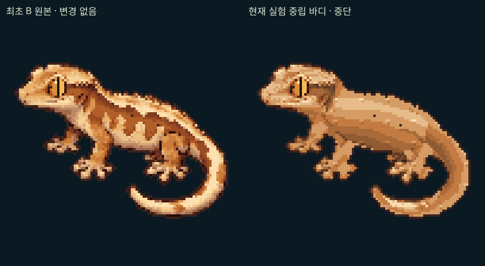

# 최초 B · 브리딩 감상형 원본 확인

수작업 무늬 추가 작업은 중단했다. 이 자료는 최초 선택한 B를 정확히 확보하고 현재 중립 바디와 비교하는 진단이며, 새로운 기본 바디나 무늬를 제안·적용하지 않는다. 정식 게임은 변경하지 않았다.

## 원본과 비교

[**원본 96×96 PNG**](B-original-96.png) · [원본 4배 확대](B-original-4x.png) · [나란히 96px](comparison-1x.png) · [부위별 4배 비교](details-4x.png)

아래 왼쪽이 최초 B 원본, 오른쪽이 수작업 조각 실험에서 사용한 실제 중립 바디다. 양쪽 모두 96×96을 정수 4배로 확대한 것이며 블러·보간·새 그림을 사용하지 않았다. 왼쪽은 고정 아트 원본이고 오른쪽은 일반 유전 배경의 재구성 바디이므로, 같은 유전체의 두 모프를 비교한 그림은 아니다.



## 1. 최초 구현의 출처

최초 추가 커밋은 [`c9cb231db4afacaffc52b6e9655d57bc9f5a6f26`](https://github.com/damyo-zip/gecko-lab/commit/c9cb231db4afacaffc52b6e9655d57bc9f5a6f26), `Explore three new native 96px gecko bases in an isolated design lab`이다.

| 역할 | 파일 / 코드 |
| --- | --- |
| 최초 원화 초안 | `docs/base-study/source-sheet.png`의 가운데 B |
| 96px 내보내기 | `scripts/compile-base-study.mjs` |
| 최종 원본 PNG | `public/lab/base-study/B-normal.png` |
| 런타임 아트 데이터 | `src/lab/appearance/base-study/art-data.ts`의 `BASE_ART.B` |
| 후보 이름·자세 주석 | `src/lab/appearance/base-study/designs.ts`의 `DESIGNS` B |
| 수정 없는 출력 | `src/lab/appearance/base-study/render.ts`의 `renderBase('B','normal')` |
| 최초 아트 배치 검토 UI | `src/app/lab/appearance/bases/study.tsx`, `/lab/appearance/bases` |

B를 처음부터 수학적으로 그리는 생성 함수가 있는 구조는 아니다. 당시 제작한 AI 보조 원화 초안이 있고, 컴파일러가 이를 네이티브 픽셀 아트로 내보냈다. 가운데 B의 출처 영역은 x=642, y=95, 810×596이다. 분리된 실루엣을 최대 88×88에 최근접 샘플링하고 96×96 안에 배치한 뒤, 제한 팔레트·이진 알파·눈 픽셀·1픽셀 외곽선을 정리했다. 이 결과가 사용자가 최초 검토 화면에서 본 B다. 이번 확인에서는 이 과정을 새로 디자인하거나 다시 생성하지 않았다.

위 6개 핵심 원본 파일은 최초 커밋과 현재 작업 트리의 **바이트가 모두 동일**하다. 최초 PNG의 SHA-256은 다음과 같다.

```text
487aa44664d047f20a6875c48715f3a083ee876ddc524d5c01150ac9f03959de
```

기존 `docs/base-study/B-normal-96.png`도 같은 파일 해시다. PNG를 디코딩한 RGBA와 `renderBase('B','normal')`의 RGBA가 일치한다. 원본은 96×96, 불투명 색 21개, 알파 0/255이고, 불투명 픽셀은 2,797개다. 원본 복사본 `B-original-96.png` 역시 파일 바이트를 그대로 보존했다.

## 2. 원본 외형은 어떻게 구성되는가

| 요소 | 최초 B의 실제 구조와 감상 포인트 |
| --- | --- |
| 실루엣 | 왼쪽을 보는 옆모습, 길고 넓은 몸통, 분리된 발과 사지, 오른쪽으로 감긴 C자 꼬리. 알파와 1픽셀 외곽선에 고정되어 있다. |
| 얼굴 | 길게 낮아지는 주둥이, 볼·턱의 밝은 면, 눈 뒤의 짙은 음영, 얇은 입선과 콧구멍. 머리 윤곽과 볏의 밝은 톱니가 표정을 만든다. |
| 눈 | B 좌표 (21,25), 정리 범위 반경 x=3·y=4. 황금색 홍채, 어두운 수직 동공, 작은 밝은 반사광이 네이티브 픽셀로 정리되어 있다. |
| 명암 | 등과 볏의 밝은 면, 목·사지 부착부의 짙은 접힘, 배 쪽과 꼬리 아래의 그림자가 원화 색 픽셀에 함께 들어 있다. 단순한 상하 밝기 그라데이션이 아니다. |
| 질감 | 크림·황토·갈색의 작은 픽셀 군집과 계단형 색 경계가 비늘·볼륨을 동시에 만든다. 밝은 무늬 안에도 밝기 차이가 있다. |
| 무늬 | 등에서 꼬리로 이어지는 크림 띠, 옆구리의 큰 불규칙 크림 경계와 갈색 창문, 사지 피복과 꼬리 무늬가 큰 흐름을 이룬다. 독립된 작은 점들의 합보다 연결된 큰 형태가 중요하다. |

원본 데이터는 96행의 팔레트 인덱스와 RGBA 팔레트다. 피부·명암·무늬가 완전히 분리된 원본 레이어는 없다. `designs.ts`의 몸통 다각형·등 경로·눈 좌표는 이후 변형을 위한 주석이며 원본 그림을 구성하는 부품이 아니다. 원본의 ‘노멀’은 이 디자인의 기본 갈색 외형을 뜻하며 특정 유전체에서 생성된 최종 모프명은 아니다.

## 3. 현재 중립 바디에서 달라진 이유

수작업 조각 실험의 경로는 `fragments/atlas.ts` → `fragments/body.ts`의 `renderNeutral()`이다. 원본 B의 알파와 해부학적 주석을 이어 썼지만 피부는 기하 기반의 새 8단계 명암·고정 요철·재질 팔레트로 다시 칠했다. 이 과정에서 원본의 크림 띠와 큰 측면 형태, 그 안의 세부 색 변화와 피부 질감이 사라졌다. 얼굴도 눈 보호 영역 밖의 피부 대부분은 재도색되었다.

알파 차이는 0픽셀이지만 불투명 2,797픽셀 중 **2,311픽셀(약 82.6%)의 RGBA가 달라졌다.** 원본 B의 피부 주석 기준으로 몸통 714/714, 사지 746/746, 꼬리 431/431픽셀이 재도색되었다. 이 수치 자체는 아름다움의 점수가 아니며, 실루엣만 유지했다고 원본 디자인이 보존된 것은 아니라는 점을 보여준다.

원본 파일을 찾지 못한 문제가 아니라, 이후 실험에서 원본의 시각적 정보를 충분히 보존하지 않는 렌더링 경로를 기본 바디로 사용한 것이 원인이다. 패턴과 명암을 분리한다는 기술적 목표를 앞세워 사용자가 선택한 B의 완성도를 희생했다. 이 중립 바디를 선택된 B의 기준으로 취급하지 않는다.

## 4. 기존 수작업 조각을 활용할 수 있는가

일부 코드는 활용 가능하지만, 현재 31개 작은 조각을 원본 B 무늬의 전면 대체물로 사용하는 것은 적합하지 않다. 원본 B의 매력은 큰 크림 띠·측면 창문·꼬리 연결과 그 안의 명암이 함께 만든다. 작은 조각을 덧붙이거나 기존 무늬를 지우는 방식은 원래 문제를 반복할 가능성이 높다.

- **유지할 수 있는 기반:** 96×96 네이티브 조각 배치, 해부학적 영역 제한, 눈·입선 보호, 결정적 시드, 기존 유전 점수 연결, 캐시와 비교·상속 검증 코드.
- **출발점을 바꿔야 하는 아트:** 원본 B의 등 띠, 큰 측면 크림 형태와 갈색 창문, 꼬리띠 자체를 수작업 패턴 세트의 기준으로 삼는 방향이 적합하다. 원본 패턴을 그대로 가진 기본형도 허용해야 한다.
- **조각이 맡을 수 있는 역할:** 원본과 맞는 명암·팔레트로 연결부·가장자리·릴리 확장·꼬리 기부/끝을 제한적으로 보강하는 보조 요소. 얼굴·몸통 전체를 새 재질로 덮는 용도로 사용하지 않는다.
- **유전적 다양성의 연결:** 기존 유전 점수로 원본 B에서 파생한 큰 패턴 구성·연결·피복 변형을 선택하고, 시드는 제한된 수작업 후보 안에서 차이를 주는 구조를 검토할 수 있다. 패턴리스 바디를 필수 중간 단계로 두지 않아도 된다.

위 내용은 활용 가능성 검토이며 이번 작업에서 새 무늬나 새 렌더러를 구현하지 않았다. 모프별 보강을 재개하기 전에 원본 B 자체가 기준 이미지로 유지되어야 한다.

## 확인 방법과 작업 상태

`XDG_CACHE_HOME=/tmp/gecko-font-cache node scripts/b-original-review.mjs`로 Git 최초 파일과의 일치, PNG/런타임 픽셀 일치, 나란히 비교와 부위별 확대를 재현할 수 있다. 중립 바디는 중단 시점의 보존 PNG를 읽으며 중단한 렌더러를 다시 실행하지 않는다. [provenance.json](provenance.json)에 전체 경로·해시·비교 입력과 픽셀 차이를 기록했다.

원본 관련 기존 테스트 7개와 원화 `--check`를 실행했다. 새 기능 개발 중이던 전체 브라우저 회귀 검사는 사용자 중단 지시에 따라 멈췄으며 전체 통과로 보고하지 않는다. 수작업 조각 코드는 미완성 작업으로 보존하고 새 조각 추가·병합·정식 적용은 하지 않았다. 정식 게임·유전·저장 데이터에 변경은 없다.
