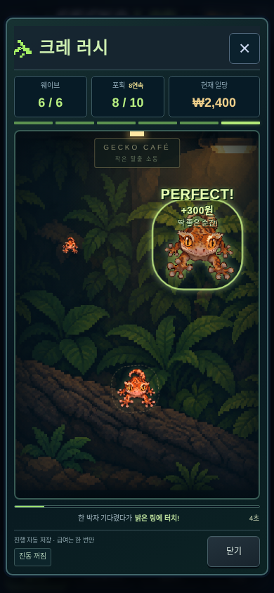
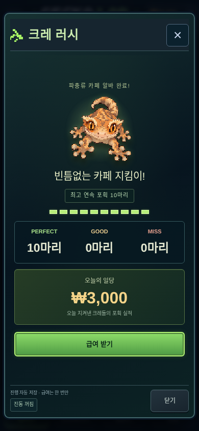
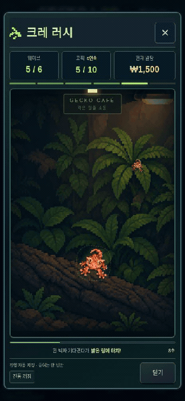

# 크레 러시 — 플레이 감각 개선

2026-10-15. 기존 크레 러시를 모바일 Chromium에서 실제 25초 동안 터치해 10마리 PERFECT를 기록한 뒤 개선했습니다. 새로운 게임·화폐·유전 시스템을 만들지 않았습니다.

## 평가와 우선순위

기존 정면 아트, 개체별 판정, 엇갈린 포획 시점과 저장/급여 처리는 보존할 가치가 있었습니다. 기존 판정이 불공정하거나 재미가 없다고 단정하지 않습니다. 관찰한 개선 여지는 다음과 같습니다.

| 기존 경험 | 개선 |
| --- | --- |
| 고정 중심에서 한 포즈를 확대 | 짧은 포물선, 좌우 뱅킹과 접근 중 발가락·꼬리 자세 변화 |
| 작은 구간이 길고 막판에 급격히 커짐 | 초중반부터 형태가 더 잘 읽히는 가속 투영 |
| 후반 위치가 거의 고정 | 두 가지 안전한 삼각 배치에서 순서를 시드로 섞음 |
| 저장 완료 전에는 누른 반응이 없음 | 즉시 접촉 자세로 고정하고, 저장 성공 후 판정·보상 표시 |
| MISS라는 결과만 표시 | 너무 이른 터치 / 놓침을 구분하는 짧은 설명 |
| 판정 수치 위주의 종료 화면 | 10칸 포획 기록, 최고 연속 포획, 일당을 순서대로 강조 |

체감 변화의 목표는 크레가 다가오는 속도를 읽고 한 박자 기다렸다가 잡는 경험입니다. 접촉 순간의 짧은 멈춤은 잡은 크레에만 적용합니다. 나머지 크레의 시계를 멈추거나 전역 화면을 흔들지 않습니다. 재미 평가는 개발자의 검토이며 사용자 플레이테스트로 검증한 결론은 아닙니다.

## 구현한 변화

- `rushGeometry`에서 비행 위치·등비 크기·회전과 이를 포함하는 최소 44px 히트박스를 함께 계산합니다. 실제 터치 판정과 밝은 링은 동일한 화면 프레임의 정수 ms를 사용합니다.
- v2의 접근 곡선은 `progress^1.65`, 최대 뱅킹은 5도, 수직 호는 20px, 초기 수평 편차는 최대 12px입니다. 포획 구간에 가까워질수록 편차가 줄어듭니다. 기존 v1의 위치·크기·판정 함수는 보존합니다.
- 정면 원본과 네 가지 피부색을 유지했습니다. 바깥 발가락·꼬리 부분의 1~2 논리 픽셀 변화를 세 자세로 미리 캐시합니다. 눈·얼굴·볏의 중앙 영역은 바꾸지 않습니다. 매 프레임 PNG를 디코딩하거나 캔버스 전체를 다시 합성하지 않습니다.
- 앞의 3웨이브는 느린 단독 크레로 배우고 뒤의 3웨이브에서 서로 다른 위치의 2/2/3마리를 차례로 잡습니다. 난이도 상승은 기존 비행 시간·엇갈린 최적 시점을 유지하며, 위치 조합을 다양하게 합니다.
- PERFECT는 짧은 접촉 정지, 링과 두 개의 픽셀 효과로 강조합니다. GOOD은 더 작은 반응, MISS는 가까이 지나쳐 나가는 움직임을 사용합니다. 미포획 판정은 체크포인트를 기다리지 않고 만료 시점에 저장을 요청합니다. 실패 문구는 원래 위치에 남아 읽을 수 있고, 크레의 이동은 실제 플레이 영역 높이를 기준으로 화면 밖까지 이어집니다.
- 3/6/10연속 포획과 DOUBLE/TRIPLE PERFECT는 연출만 제공합니다. 연속 기록은 저장된 판정의 시간순에서 계산하며 별도 카운터나 보상 필드를 저장하지 않습니다.
- HUD는 웨이브·포획·일당을 유지하고 6개 진행 표시, 남은 초, 웨이브 사이의 간단한 안내를 제공합니다. 시작·종료 화면의 여백과 정보 위계를 정리했습니다.
- 진동은 기본 꺼짐이며 사용자가 선택해야 합니다. 기기 미지원/오류는 플레이에 영향을 주지 않습니다. 소리는 추가하지 않았습니다. 동작 줄이기 설정에서는 장식 애니메이션과 뱅킹을 줄입니다.

## 보존한 계약과 저장 호환

25초 · 6웨이브 · 10마리 · PERFECT 300원 / GOOD 200원 / MISS 0원 · 최대 3,000원 · 게임 턴당 한 번을 유지합니다. 포획 창도 기존 PERFECT 74~88%, GOOD 50~98%입니다. 새 단위 테스트에서 드러난 경계 부동소수점 문제는 v2에서 타임스탬프를 직접 비교해 처리합니다. 이미 진행 중인 v1 판정을 재계산하지 않습니다.

신규 알바는 `cafeRush.version = 2`, 기존 알바는 `1`로 이어갑니다. 같은 턴에 다른 규칙의 백업을 복원해서 배치나 확정 판정을 다시 추첨하지 않습니다. v1 수령 기록을 지우거나 새 원장으로 갈아타지 않습니다. 기존 `rush-v1:<gameId>:<seed>` 키의 **원장 형식 버전 1**은 그대로이며 내부 알바 규칙 버전과 구분합니다.

닫기·백그라운드·재접속 시 이어하기, 미수령 급여, 화폐/수령의 같은 IndexedDB 트랜잭션, 다중 창 비교, 과거 백업의 진행 상한을 유지했습니다. 백업 복원 시 자금을 자동 가산하지 않습니다. 컬렉션·교배·유전·시장·사육장·인큐베이터의 데이터 구조와 규칙은 변경하지 않았습니다.

## 화면과 실제 플레이

[시작 전후 비교](cre-rush-polish/intro-comparison.png) · [포획 전후 비교](cre-rush-polish/catch-comparison.png) · [결과 전후 비교](cre-rush-polish/result-comparison.png)

[360px 시작](cre-rush-polish/intro-360.png) · [390px 시작](cre-rush-polish/intro-390.png) · [430px 시작](cre-rush-polish/intro-430.png). 이전 화면은 커밋 `7a471d5`의 캡처를 보존했습니다. 위치·크레 색상은 시드와 배치 버전에 따라 달라지므로 픽셀 일치 비교가 아닙니다.

[25초 전체 플레이 영상](cre-rush-polish/play-390.webm) · [프레임·터치·저장 판정 기록](cre-rush-polish/playback-review.json) · [실패 안내 화면](cre-rush-polish/miss-360.png). 영상은 별도의 실제 모바일 뷰포트 플레이를 녹화한 것이며, 10 PERFECT / 3,000원입니다. 10개 입력 모두 화면 표시 ms와 저장 판정 ms가 일치했습니다. 녹화한 단일 headless 세션에서 rAF 간격 중앙값·95백분위는 약 16.7ms, 50ms 초과 프레임은 0개였습니다. 실제 기기의 성능 수치를 뜻하지 않습니다.

## 검증

기존 테스트를 삭제하거나 건너뛰지 않고 아래 검증을 완료했습니다.

- 단위 테스트 23파일 / 277개 통과. 기존 판정·경제·저장·게임 시스템 회귀에 v1 고정 계획/급여, 규칙 교체 방지, 움직임과 회전 히트박스, 판정 경계, 실패 설명/연속 기록을 추가했습니다.
- 모바일/PC 크레 러시 관련 18개 통과: 실제 25초 10마리 터치, 동시 등장과 다른 크레의 계속된 접근, GOOD/MISS, 닫기/새로고침/백그라운드, 중복 터치, 급여 1회, 다중 창, 쓰기 실패의 원자적 취소, 오프라인/백업, v1 이어하기→수령→다음 턴 v2, 눈 보존/자세 변화, 진동 기본 꺼짐/선택/복원.
- 전체 E2E **172개 통과**. 최종 실패 연출 정리 후 관련 단위 **20개**, 모바일/PC E2E **18개**를 다시 통과했습니다. 타입 검사·프로덕션 빌드·기존 아트 PNG/runtime 해시 검사도 통과했습니다.
- 360×800·390×844·430×932 및 360×640, 데스크톱을 확인했습니다. 눈 픽셀 보존과 발가락 자세 변화, 동작 줄이기, 실패 문구는 고정된 채 크레만 빠져나가는 동작을 실제 DOM/Canvas에서 검증했습니다.

## 한계

- 검증은 터치 입력을 사용하는 실제 Chromium 브라우저입니다. 실물 iPhone/Safari, 저사양 Android의 발열·프레임 유지율과 실제 진동 감각은 별도 기기 검증이 필요합니다.
- 기존 생성 원화를 96px로 샘플링한 아트입니다. 자세는 작은 절차적 변형이며 아티스트가 새로 그린 관절별 점프 프레임이나 3D 모델은 아닙니다. 다음 아트 단계에서는 같은 세 비행 구간에 손으로 그린 자세를 연결할 수 있습니다.
- 무음이며 진동은 선택 기능입니다. 서버 계정 기반 부정행위 방지는 추가하지 않았습니다.
- 다음 개선은 실제 플레이어가 너무 빠르게 누르는지, 후반 최적 시점을 읽는지 관찰한 뒤 결정하는 것이 좋습니다. 플레이테스트 없이 판정 창이나 최대 보상을 더 변경하지 않았습니다.

## 주요 파일

`src/game/rush.ts` · `src/components/hardcore/cafe-rush.tsx` · `src/components/hardcore/rush-sprite.tsx` · `src/app/cafe-rush.css` · `tests/rush.test.ts` · `tests/fixtures/rush-v1-plan.json` · `e2e/rush.spec.ts` · `public/sw.js`.
