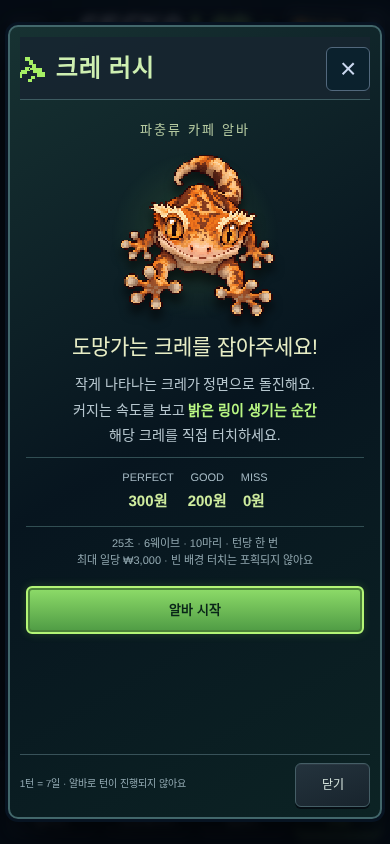
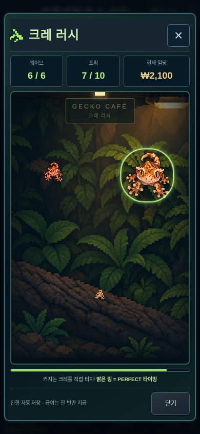
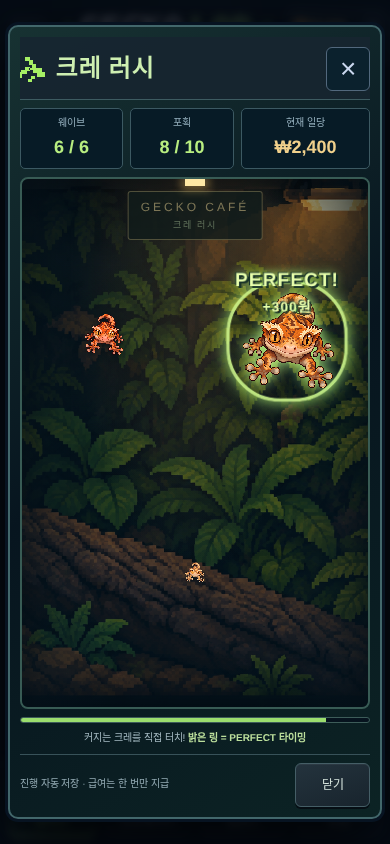
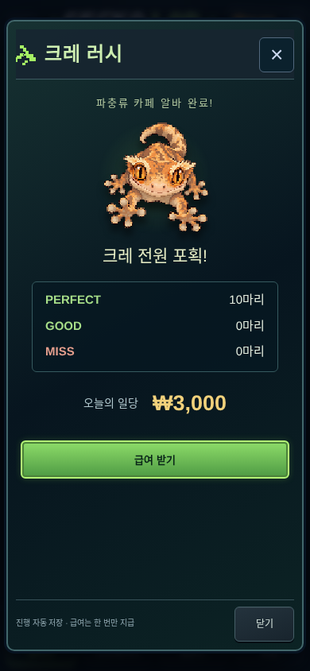

# 크레 러시 — 파충류 카페 알바

공통 헤더의 게임머니 + 버튼에서 여는 실제 터치 미니게임입니다. 컬렉션·인큐베이터·혈통도·상점 모두 같은 헤더와 같은 팝업을 사용합니다. 기존 상점은 하단 상점 탭으로 접근합니다. 플레이 중에는 상·하단 UI를 복제하지 않습니다.

## 플레이

25초 동안 6웨이브에 1/1/1/2/2/3마리, 총 10마리가 등장합니다. 무작위로 정한 화면 안쪽 위치에 작게 나타나자마자 정면으로 다가옵니다. 기존 측면 스프라이트와 별개로 제작한 정면 점프 아트를 사용하며, 원근감은 가속 확대(`progress^2.3`)로 표현합니다. 초반 세 마리는 약 3초, 후반은 약 2.2~2.5초에 걸쳐 접근합니다.

각 크레의 등장·비행 시간·위치·색상·판정은 독립적입니다. 여러 마리는 겹치지 않는 위치 영역을 사용하고 등장 및 최적 시점을 약 0.8초씩 엇갈리게 배치합니다. 앞의 크레를 잡아도 나머지의 requestAnimationFrame 진행은 계속됩니다. 직접 누른 개체 ID에만 입력하며 빈 배경을 눌러 가까운 크레를 자동 포획하지 않습니다.

| 판정 | 접근 진행도 | 급여 |
| --- | --- | --- |
| PERFECT | 74~88% | 300원 |
| GOOD | 50~74% / 88~98% | 200원 |
| MISS | 50% 전 터치 / 98%까지 미포획 | 0원 |

밝은 링이 PERFECT 시점을 보조합니다. 초반 PERFECT 구간은 약 460ms, 후반 약 315ms이며 속도를 보고 예측해서 잡을 수 있습니다. 입력은 화면에 마지막으로 표시한 프레임의 접근 시간으로 판정합니다. 히트 영역은 최소 44px이고 확대와 같은 중심/크기를 사용합니다. 개체별 동기적 중복 입력 방지와 엔진의 결과 불변 검사를 함께 적용합니다. PERFECT/GOOD은 붙었다가 사라지고 MISS는 커지며 화면 밖으로 빠져나갑니다. DOUBLE/TRIPLE CATCH는 연출만 제공하며 추가 화폐는 없습니다.

게임 완료 후 실제 PERFECT×300 + GOOD×200의 일당을 **급여 받기**로 기존 `game.money`에 지급합니다. 최대 3,000원이며 알바가 게임 턴·날짜·급여용 사료·번식 RNG·시장 재고를 진행시키지 않습니다. 다음 게임 턴에 다시 일할 수 있습니다.

## 중단·저장·복원

- 닫기는 진행 저장을 기다린 뒤 팝업을 닫습니다. 다시 열면 **알바 계속하기**에서 이어갑니다.
- 백그라운드/페이지 이탈은 플레이 시계를 멈추고 저장을 시도합니다. 돌아온 뒤 계속하기를 눌러야 재개하며 숨겨진 동안의 현실 시간은 더하지 않습니다.
- 약 800ms 간격 및 직접 터치·닫기·마지막 프레임에 체크포인트를 기록합니다. 포획 결과와 급여 수령은 저장 성공 후 표시합니다. 저장 대기 중에도 다른 크레는 계속 움직이고 터치는 순서대로 저장합니다.
- 갑자기 브라우저가 종료되면 마지막 완료된 체크포인트(통상 800ms 간격)로 복구합니다. 저장 대기 중이던 움직임은 다시 보일 수 있으나, 이미 확정해서 표시한 포획·급여를 다시 지급하지 않습니다.
- 완료 후 미수령 상태도 저장합니다. 이전 턴의 미완료/미수령 알바가 남았다면 이를 먼저 이어서 마치거나 급여를 받은 뒤 현재 턴의 새 알바를 시작합니다.
- 저장 오류가 나면 일시 정지하고 오류를 표시합니다. 실패한 판정을 보상으로 확정하지 않으며 저장 재시도 또는 최신 저장 새로고침을 제공합니다.

저장 v9에 **선택적인 `cafeRush` 버전 1 확장**을 사용합니다. 기존 v9에 필드가 없으면 미플레이이며, 이전 저장의 유전형·일정·화폐·개체를 새로 만들거나 초기화하지 않습니다. 기존 v2~v8의 이전 경로도 유지합니다. 크레 러시 확장이 담긴 새 백업은 해당 기능을 지원하는 최신 앱에서 복원해야 합니다. 확장은 게임·시작 턴, 고정 시드에서 재생되는 규칙 버전, 진행 ms, 10개 판정과 수령 여부를 저장합니다. 저장에 임의의 보상 금액을 넣는 대신 판정으로 계산합니다.

같은 IndexedDB `games` 저장소에 게임 ID·시드별 진행/수령 상한 기록을 둡니다. 이 기록과 `active` 저장은 **하나의 readwrite 트랜잭션**으로 갱신합니다. 기존 리비전 비교로 다중 창의 동시 지급을 막고, 쓰기 실패 시 급여와 수령 기록을 함께 취소합니다.

같은 기기에서 예전 백업을 복원해도 이미 시작·완료·수령한 턴의 진행 기록을 되돌리지 않습니다. 같은 턴의 확정 결과를 바꾸지 않으며, 더 늦은 턴의 백업/수령 기록은 더 이른 타임라인으로 되돌리지 않습니다. **화폐는 백업에 담긴 금액을 그대로 복원**하고 복원 과정에서 급여를 자동 가산하지 않습니다. 따라서 수령 전 백업으로 돌아가면 자금 역시 수령 전 금액으로 돌아가며 이미 수령한 급여를 다시 받을 수 없습니다. 복원 확인 화면에도 이 규칙을 안내합니다.

브라우저 데이터를 지우거나 다른 기기에 과거 백업을 가져가는 것까지 검증하는 서버 기반 부정행위 방지는 없습니다. 백업 자체의 지급 상태, 동일 기기의 영구 수령 기록, 다중 창 원자성을 보호하는 로컬 게임입니다.

## 그래픽과 한계

[360px](cre-rush/intro-360.png) · [430px](cre-rush/intro-430.png)에서도 검사합니다. 캡처는 Chromium 모바일 터치 에뮬레이션의 실제 프로덕션 빌드입니다. 실물 iOS/Safari는 별도 검증이 필요합니다.

정면 원화는 이번 기능을 위해 생성한 투명 PNG입니다. 원본은 고해상도이며 이를 96×96에 최근접 샘플링합니다. 전문 아티스트가 제작한 네이티브 96px 다중 프레임 스프라이트와 동일한 품질이라고 주장하지 않습니다. 하나의 정면 포즈를 등비 확대하므로 3D 회전·사지의 개별 관절 움직임·물리 비행 궤적은 없습니다. 몸의 명암을 보존한 네 가지 색상은 카페 연출용이고 플레이어 개체의 모프/유전형을 표현하지 않습니다. [원화 출처·해시·픽셀 처리](../public/art/cre-rush/README.md)를 기록했습니다.

## 주요 파일

- `src/game/rush.ts`: 버전 고정 설정, 결정적 웨이브/위치, 판정·급여·검증·저장 기록 병합·기하.
- `src/components/hardcore/cafe-rush.tsx`: 활성 시계·터치 큐·일시 정지·체크포인트·연출·결과 화면.
- `src/components/hardcore/rush-sprite.tsx`, `public/art/cre-rush`: 별도 정면 원화와 96px 렌더링/색상 캐시.
- `src/app/cafe-rush.css`: 기존 테라리움 배경과 패널/버튼을 사용하는 독립 팝업 스타일.
- `home-header.tsx`, `hub.tsx`: 공통 + 진입점, 기존 모달 재사용.
- `src/game/hardcore/model.ts`, `play.ts`, `validation.ts`: 선택적 저장 확장과 기존 화폐 행동 연결.
- `src/storage/hardcore.ts`: 원자적 수령 기록·복원 시 재지급 방지. `settings.tsx`에 복원 금액 안내.
- `tests/rush.test.ts`, `e2e/rush.spec.ts`: 판정·경제·저장·모바일 실플레이 검증.

설정은 `RUSH_V1` 한 곳에 모읍니다. 향후 난이도/보상/웨이브 규칙을 바꿀 때는 새 규칙 버전을 추가하고 기존 v1을 유지해야 이미 시작한 알바와 저장된 판정이 바뀌지 않습니다.

## 검증

단위 검증은 6웨이브/10마리, 시드 재현성, 여러 모바일 크기에서의 히트 영역 경계·겹침, 최적 시점 간격, 가속/판정 구간, 개별/중복 입력, 자동 MISS, 3,000원/혼합 1,800원/0원 급여, 중복 수령, 턴 재개, 미완료/미수령 복원, 손상된 저장, 오래된 백업과 진행 상한 기록을 다룹니다. 기존 실제 번식·알·유전형·시장·날짜를 가진 저장에서도 알바 행동 전후를 비교합니다.

브라우저는 네 탭의 공통 + 진입, 360/390/430px 및 짧은 화면, 실제 25초 동안의 10마리 직접 터치, 세 마리 동시 접근, PERFECT/GOOD/이른 MISS/자동 MISS, 빈 배경 무시, 한 번만 지급, 다음 턴 기회, 닫기/새로고침/백그라운드, 미수령/이전 백업 복원, 두 창 동시 수령, active 쓰기 실패 후 영구 기록과 화폐의 동시 롤백을 확인합니다. 테스트에서만 저장 쓰기 오류를 주입하며 제품 코드에 우회 보상 경로는 추가하지 않습니다.

타입 검사·프로덕션 빌드·기존 아트 해시 검사를 통과했습니다. 전체 단위 **23파일 / 272개**, 전체 모바일/PC E2E **168개**를 통과했습니다. [검증 요약](cre-rush/validation.json), [모바일 입력 기록](cre-rush/touch-timing-mobile.json), [PC 입력 기록](cre-rush/touch-timing-desktop.json)에 결과를 남깁니다. 20개 실제 입력의 표시 프레임 ms와 저장된 판정 ms가 모두 일치합니다. 마지막 헤더 오류 상태 보존 뒤 동시/오래된 창 관련 E2E **4개**도 다시 통과했습니다. [전원 포획·급여 미수령 검토 백업](cre-rush/review-save.json)은 테스트용 새 게임이며 플레이어 게임에 자동 설치하지 않습니다.
