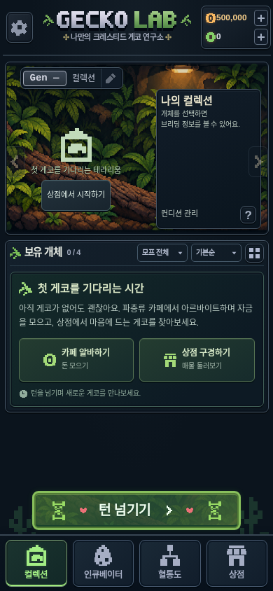

# 보유 개체가 없을 때의 예비 브리더 안내

컬렉션의 빈 보유 개체 영역을 **첫 게코를 기다리는 시간** 패널로 교체했습니다. 카페 알바로 자금을 모으고 상점 매물을 둘러보는 플레이를 안내합니다. 기존 빈 안내와 `상점 보기` 버튼은 이 영역에서 제거했습니다.

상단 `나의 컬렉션` 대표 패널, 보유 수·정렬·필터·보기 전환, 하단 턴 버튼과 내비게이션은 유지했습니다. 패널의 두 버튼은 가로 2열·62px 높이이며 기존 프레임·픽셀 아이콘·글꼴·녹색 강조를 사용합니다. 빈 공간을 강제로 채우지 않습니다.

- **카페 알바하기 / 돈 모으기**: 헤더의 게임머니 +와 같은 `openRush`를 호출합니다. 기존 허브의 단일 `CafeRush` 팝업을 열며 시작·급여·진행 상태를 만들거나 초기화하지 않습니다. 이미 완료한 알바는 같은 완료 화면을 표시합니다.
- **상점 구경하기 / 매물 둘러보기**: 기존 상점 탭으로 이동합니다. 매물을 다시 생성하거나 돈을 차감하지 않습니다.
- 표시는 기존 `owned(game).length === 0`에 연결합니다. 판매·폐사·외부 부모 기록은 보유 수에 포함하지 않습니다. 보유 개체가 있지만 필터 결과만 비었을 때는 기존 필터 안내를 표시합니다. 첫 구매 여부 같은 영구 상태는 추가하지 않았습니다.

변경 파일은 `collection.tsx`, `hub.tsx`, `reference-home.css`, 오프라인 쉘 캐시 버전의 `sw.js`와 검증 파일입니다. 게임 모델·경제·알바·턴·교배·유전·저장 로직은 수정하지 않았습니다.

## 화면

[360×800](empty-collection/guide-360-800.png) · [430×932](empty-collection/guide-430-932.png) · [320×640](empty-collection/guide-320-640.png) · [360×640](empty-collection/guide-360-640.png)

작은 화면에서는 기존 중앙 콘텐츠 스크롤을 사용하며 패널과 고정 하단 컨트롤이 겹치지 않도록 확인했습니다. 캡처는 실제 Chromium 모바일 터치 에뮬레이션이며 실물 기기 검증은 아닙니다.

## 검증

`e2e/empty-collection.spec.ts`의 모바일/PC **8개**가 통과했습니다. 패널 표시·중복 안내 제거·버튼 크기/2열/넘침·기존 대표 패널/필터/하단 유지, 알바 팝업 단일 연결·미시작 상태 불변·진행 공유·재접속, 보유 0마리의 급여 1회·양쪽 진입 경로의 완료 상태·다음 턴 재개, 상점 상태 불변·실제 구매·필터 빈 상태·마지막 개체 판매·폐사 기록 복원을 검증했습니다.

타입 검사·프로덕션 빌드와 기존 단위 **277개**가 통과했습니다. 전체 모바일/PC E2E **180개**도 통과했습니다.
