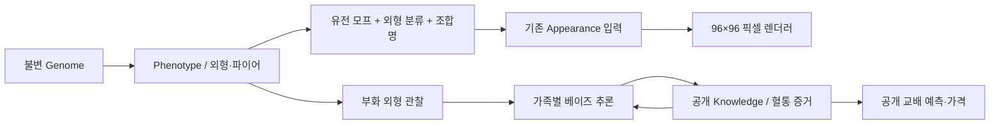

# Phase 5 유전 모델과 검증 범위

게임의 목표는 명시적 대립유전자 전달과 플레이어의 브리딩 지식입니다. DNA로 확정되지 않은 브리더 작업 모델과 가상 유전자를 실제 유전학으로 혼동하지 않습니다. 검토 날짜: **2026-10-13**.



## 좌위와 실제 열람 자료

| 모델 | 출처와 직접 확인한 범위 | 근거 수준 / 이견 / 정책 |
| --- | --- | --- |
| Lilly White | [Corch Geckos 프로젝트 기록](https://www.corchgeckos.com/lillywhite.html): 이형접합 외형과 super의 비생존 보고. [Gecktopia 근거 설명](https://www.gecktopia.com/learn/where-the-genetics-come-from): 불완전 우성·수정 시점 비생존 구분 | 브리더 관찰 지원, DNA 확정 아님. n/n 일반형, n/Lw 발현, Lw/Lw 비생존. 두 발현 부모 교배 차단 |
| Axanthic | [IB EXOTIC 2024-01-28](https://www.ibexotic.com/post/axanthic-crested-gecko): 열성 AA/Aa/aa 교배와 66%/50% possible het 설명 | 브리더 설명 지원, 한 호환 라인만 게임에서 사용. 실제 모든 라인의 호환성을 확인하지 않음 |
| C/S/H 복합 좌위 | [Foundation Genetics Super Cappuccino PSA v1.2, 2026-09-08](https://lmreptiles.com/fg-scapppsa/): Cappuccino가 Sable·Highway와 allelic이라는 보고; Super Cappuccino·Sorak·Luwak·Capp/Highway 및 Super Sable 건강 위험 경고 | 브리더 잠정 모델, 분자 확인 아님. n/C/S/H 한 좌위의 네 대립유전자. 두 변이 사본의 조합은 모두 차단 |
| 근거 평가 | [Gecktopia evidence grades](https://www.gecktopia.com/morphs/grades): DNA 확인, 브리더 지원, 잠정/이견, 외형·라인 이름의 구분 | 모델의 근거 수준을 설명하는 참고 자료이며 독립 실험의 반복 검증으로 세지 않음 |

모든 링크는 위 검토 날짜에 HTTP 200으로 실제 열람했습니다. 다른 프로젝트의 코드·그림·아트 자산은 복제하지 않았습니다. 동일 연구를 소개하는 여러 글을 여러 독립적인 실증 자료로 세지 않습니다. 수의학적 진단·사망 시점·현실 사육 결과를 예측하는 모델이 아닙니다.

C/C, C/S, C/H, S/S는 PSA 건강 경고를 반영합니다. S/H, H/H는 안전성이 확인되지 않아 보수적으로 차단합니다. **건강 위험 조합의 생성 확률과 실제 사망 확률은 다릅니다.** C/S/H를 수정 순간 무조건 사망으로 모델링하지 않으며, 계산기의 이론적 생존 조건부 확률에서도 임의의 사망률을 적용하지 않습니다. 실행만 안전 정책으로 차단합니다. Sorak은 C/C와 Lilly 조합명이며 독립 유전자/희귀 보상이 아닙니다.

현재 매물 생성은 기존 Normal/Lilly/Ax 범위입니다. C/S/H는 유전체·상속·조합 계산·안전 정책과 학습 계산기까지 지원합니다. 새 가격이나 전용 아트가 없는 C/S/H 매물을 임의로 판매하지 않습니다.

## 멘델 계산 계약

`advanced/model.ts`의 `Locus`는 ID, 대립유전자, 유전 방식, 유전형별 표현 규칙, 모델 버전, 비생존·차단 규칙, 근거 메타데이터와 연관 확장 정보를 가집니다. `gametes`는 동형접합 사본을 합산하고 부모로부터 각각 한 사본을 전달합니다. 각 좌위는 독립이며 두 좌위 AaBb×AaBb의 9개 유전형과 완전 우성 9:3:3:1을 검증합니다. 실제 연관 좌위를 등록하면 계산을 거부하며 근거 없는 재조합률을 쓰지 않습니다.

`cross`는 전체 독립 조합과 동일 표현형의 합산, 수정 시점 P(유전형), P(유전형|비생존 제외), 비생존 합계, 정책상 차단 합계를 각각 반환합니다. 위험 결과도 계산기에 표시할 수 있으나 `breedingCheck`가 게임 실행을 거부합니다. 분석용 샘플러는 위험 결과를 생성할 수 있고 게임은 이를 수집·보상으로 만들지 않습니다.

Lilly×Lilly: 수정 25% n/n, 50% n/Lw, 25% Lw/Lw; 비생존 제외 조건부 1/3, 2/3. Aa×Aa: 25% AA, 50% Aa, 25% aa. 조건부 Normal 자손은 AA 1/3, Aa 2/3입니다. Aa×AA의 Normal은 50% possible het입니다. 매 알은 독립이며 한 클러치의 수가 이론 비율을 보장하지 않습니다.

조합명은 `morphs.ts`의 표현형 상호작용입니다. Frappuccino=Lilly+Cappuccino, Sorak=Lilly+Super Cappuccino; 이 이름의 추가 좌위는 없습니다. 할리퀸·트라이컬러·달마시안·핀스트라이프는 외형 분류이며 독립된 멘델 유전자를 발명하지 않습니다.

## 가상 다유전자 모델 — 실제 원인 유전자 아님

60개 가상 이배체 좌위를 저장합니다. 10종 형질에 각각 6개이며 각 사본은 효과 -1, -.5, 0, .5, 1에 해당하는 0~4 코드입니다. 자손은 **좌위마다 부모의 사본 하나씩** 상속합니다. 부모의 최종 점수 평균에 랜덤 잡음을 더하지 않습니다.

설정은 `POLY_CONFIG`에 둡니다. 가산 효과, 선택적 우성 효과(현재 0), 공유 효과, 발현 상태를 분리합니다. 옆구리/크림은 할리퀸에, 명도는 대비에 함께 영향을 주도록 명시적 게임 효과를 둡니다. 합산 효과는 사본 수의 제곱근으로 정규화하고 로지스틱 함수로 0~1 내부에 변환하며 경계를 강제로 잘라 0/100에 쌓지 않습니다. 형질별 초기 분포·절편도 데이터입니다. 현재 돌연변이는 꺼져 있어 새로운 모프/사본을 랜덤 이벤트로 만들지 않습니다.

세대 수는 어떤 점수 계산에도 사용하지 않습니다. 선택교배로 좋은 사본의 비중을 늘리거나 잘못 선택해 잃을 수 있습니다. 다양성은 사본 빈도 기반 평균 이형성 지표로 측정합니다. 실제 유전 질환·근친계수·염색체 또는 과장된 질병을 추가하지 않습니다. 게임의 직계 전체와 최근 2세대 공통 조상 차단은 그대로입니다.

표현형의 파이어 상태와 Ax의 색 억제, Lilly의 크림 확대는 유전체를 바꾸지 않습니다. 성장 단계는 별도 발현 컨텍스트이며 이번에는 단계별 색 변화/아트를 추가하지 않습니다. 렌더러 연결은 `hardcore/adapter.ts`만 담당하고 유전 엔진에 Canvas/React/브라우저 의존성이 없습니다. 명도·적색·오렌지는 기존 팔레트로 양자화하고 핀스트라이프·대비는 등/측면 면적에 근사 연결합니다. 전용 핀·다리 분포를 렌더러에 새로 그렸다고 주장하지 않습니다.

## 내부 진실과 공개 지식

`GeneticsRecord.genome`은 생성 후 불변인 진실, `knowledge`는 플레이어의 사전/사후확률과 출처·관찰 ID입니다. 매물의 실제 genotype은 구매 전부터 고정합니다. Normal AA와 Aa에 같은 외형/증거가 있다면 표시 모프·교배 예상·가격도 같아야 합니다. 단지 숨은 Aa가 있다는 이유로 가격을 올리지 않습니다.

정보 부족은 `probabilities: null`입니다. 모든 Normal에게 66.7%를 붙이거나 무근거한 AA 확정을 하지 않습니다. 출처는 외형, 부모 정보, 자손 검증, 판매자 제공, 이전 기록, 정보 부족을 구분합니다. 상점 50%/66.7%는 판매자 부모 교배 정보에 근거한 게임 생성 사전확률이며 게임 내 부모 ID가 있는 혈통과 구별합니다. 판매자 거짓말 모델은 이번에 넣지 않았습니다.

`inferFamily`는 한 좌위의 **두 부모 잠재 상태를 함께 정확히 열거**합니다. 관찰된 형제들의 우도를 각 잠재 상태에서 곱하고 정규화하므로 공유 부모를 독립적인 표본으로 오해하지 않습니다. 예: 2/3 possible het×aa에서 Normal 자손 1마리 관찰 후 1/2, 2마리 후 1/3. aa 자손을 관찰하면 Aa 부모를 확정합니다. Normal만 나온 횟수가 유한한 동안 Aa 확률은 양수입니다.

게임은 같은 날 부화한 해당 클러치의 성공 자손만 한 번 관찰합니다. 산란 시 내부 유전체·성별·무늬 시드·자손의 최초 공개 정보가 정해지지만 UI는 부화 전 결과를 보여주지 않습니다. 실패 알의 내부 genotype을 증거로 사용하지 않습니다. 교배 당시 부모 유전체/공개 지식, 예상 확률, 관찰 ID, 추론 전후를 저장합니다. 다른 가족의 새 교배는 현재 주변확률을 전달하는 **근사**이고 먼 혈통·가족 간 상관관계를 정확히 통합하는 글로벌 추론기는 미구현입니다. 이전 부모 증거의 변화가 모든 과거 자손의 확률을 자동으로 재계산하지도 않습니다. 이 확장점은 순수 추론 모듈 경계에 둡니다.

매도 가격은 기존 가격표의 보인 배율에 공개 보인 확률과 정보 출처 보정을 적용합니다. 판매자 제공은 확인된 게임 혈통보다 낮은 신뢰 보정을 사용합니다. 시장 가격표·출처·이미 완료된 판매의 금액/버전은 바꾸지 않습니다. 외형점수와 실제 유전 가치가 가격 그 자체는 아닙니다.

## 저장 v5와 과거 기록

- v2: 기존 이전 경로로 날짜·하트·용량을 설정하고 이전 게임의 ID·수치·부모·알·시드를 보존합니다. 과거 미접속 날짜를 발명하지 않습니다.
- v3: 이전 규칙 검증과 체크섬 확인 후 기본 턴 모드를 더합니다. 논리 날짜·하트·혈통·판매를 유지합니다.
- v4: 이전 구조와 체크섬을 검증하고 시간 방식/현실 앵커를 그대로 유지합니다.
- 공통: 과거 명시 좌위는 `legacy` 출처로 유지합니다. 누락 Ax/복합 좌위는 미확인입니다. **숫자 외형에서 가상 사본을 역으로 만들어내지 않고 `genome: null`**을 기록합니다. 기존 외형·무늬 시드와 이미 결정된 알 결과는 변경하지 않습니다. 이 부모와의 자손은 기존 평균/변이 모델로 표시하며 정확한 가상 유전형을 주장하지 않습니다.
- v5: 신규 유전체·공개 지식·가족 관찰·표현 모델 버전까지 보존합니다. 원본 active v2/v3/v4는 자동 이전과 같은 IndexedDB 트랜잭션에 아카이브됩니다. CAS 충돌·저장 후 UI 반영·수동 JSON 복원과 원본 손상 보존은 그대로입니다.

검증은 기존 구조/달력/판매/혈통 검사와 신규 유전체 검사로 나눕니다. 필수 좌위, 사본 범위, 부모 상속, 캐시 수치, 지식 확률 합계, 중복 관찰, 산란 시드 재현, 알/자손 유전체 일치, 건강 위험을 검사합니다. Node/Chromium의 초월함수 소수점 차이는 외형 점수 비교 오차 1e-12만 허용합니다. 유전자·시드·부모 ID는 엄격하게 비교합니다. 체크섬은 보안 서명이 아니며 로컬 파일에 진실이 담긴 게임은 안티치트가 아닙니다.

## 검증 결과와 재현

`npm test`의 기존 81개 검사를 유지하고 18개를 추가합니다. 멘델·표현형 9:3:3:1·복수 대립유전자·위험·66.7%·정확한 가족 베이즈·가상 60좌위 상속·파이어 분리·저장 이전·가격 비누설을 검사합니다. 실제 게임 reducer로 무혈연 파트너와 급여하며 **자손 20세대, Gen 21**을 만들고 매 세대 백업/복원합니다. 판매·폐사 조상의 유전체와 부모 ID도 남습니다.

```sh
node scripts/genetics-report.mjs > /tmp/gecko-genetics-report.json
```

[저장한 원시 결과](genetics-simulation.json)는 고정 시드, 표본 수, 이론/실측 빈도, 표준화 오차, 세대별 평균/다양성을 포함합니다.

| Aa×Aa 100,000회 | AA | Aa | aa |
| --- | --- | --- | --- |
| 이론 | 25% | 50% | 25% |
| 실측 | 25.057% | 50.044% | 24.899% |
| 표준화 오차 z | 0.416 | 0.278 | -0.738 |

5σ 허용 범위로 검사했으며 모든 항목은 1σ 이내입니다. 3개 시작 집단(각 100마리)의 붉은 발색 선택교배는 초기 평균 35.07~36.04점에서 20세대 88.06점으로, 무선별 대조는 33.48~36.05점으로 나타났습니다. 평균 다양성은 선택 집단에서 약 .735~.738 → .425~.463으로 줄었습니다. 이 실험은 가상 대립유전자 분포의 변화이며 현실 육종 예측이나 게임에서 근친 교배를 허용하는 시나리오가 아닙니다.

브라우저 E2E는 360×800 터치와 데스크톱에서 공개 예상, possible het 구매, aa와 교배, 부화 관찰, 보인자 확정, 이름·성장·파이어·새로고침·혈통, 잠정 위험 계산기, v4 원자 이전/아카이브를 확인합니다. 전체 테스트 결과와 원본 모바일 캡처는 README에 기록합니다.

[Phase 3 당시 모델 기록](genetics-model-phase3.md)은 역사 자료입니다. 현재 모델의 범위와 검토 상태는 이 문서가 기준입니다.
