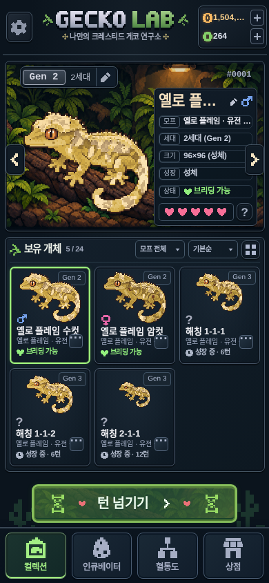

# 성장 단계별 개체 표시 크기

기존 `Gecko.stage` / `Individual.stage`를 그대로 읽어 **해칭 50% · 아성체 75% · 성체 100%**로 표시합니다. 기준은 각 화면의 기존 성체 이미지 크기입니다. 기존 6턴 아성체·12턴 성체 판정과 교배·은퇴 조건은 변경하지 않았습니다.

## 공통 구현

- `src/components/sprite-canvas.tsx`와 `sprite-canvas.module.css`에 표시 비율을 한 번만 정의했습니다. 기존 `scale=1|3|4`는 Canvas 래스터 해상도이며 이번 표시 비율과 별개입니다.
- Canvas 비트맵·원본 PNG·마스크·96×96 렌더링·외형 시드·표현형은 유지합니다. **CSS transform만 적용**하므로 기존 이미지 영역과 카드의 레이아웃 크기는 줄어들지 않습니다.
- 기존 중앙 배치/좌우 반전 변환 뒤에 성장 스케일을 합성합니다. 상점·혈통도에서 축소할 때 중심이 밀리는 문제를 방지하고, 교배 수컷의 반전도 보존합니다. 기존 성체의 프레임·배치는 유지합니다.
- 컬렉션 카드와 혈통도 대표 이미지의 어린 개체는 같은 이미지 영역 중앙에 배치합니다. 배지·이름·상태·버튼은 축소하거나 옮기지 않습니다.
- 단계 변경은 현재 상태를 렌더링할 때 즉시 반영합니다. 크기 전환 애니메이션·타이머·추가 성장 상태는 없습니다.

정식 게임의 공통 `Sprite`, Phase 2 회귀 게임의 `GameSprite`, 컬렉션 대표/카드 및 전체 목록의 직접 Canvas 경로에 연결했습니다. 따라서 상세·교배·개체 선택·혈통 앨범/가족/세대 비교·상점/부모·부화 결과에서도 동일하게 적용됩니다. 성장 단계가 없는 렌더링 연구실 예제, 알 이미지와 별도 정면 아트를 쓰는 크레 러시 NPC는 기존 표시를 유지합니다.

주요 변경 파일:

- `src/components/sprite-canvas.tsx`, `sprite-canvas.module.css`: 공통 표시 비율.
- `src/components/hardcore/common.tsx`, `collection.tsx`, `collection-catalog.tsx`, `src/components/game/common.tsx`: 기존 단계 전달.
- `src/app/reference-home.css`, `reference-shop.css`, `reference-lineage.css`, `reference-breeding.css`: 기존 위치/반전 합성, 어린 개체의 중앙 정렬.
- `public/sw.js`: PWA 셸 캐시 갱신. 게임 저장 버전은 유지합니다.

## 검증

`e2e/fixtures/growth-scale.ts`는 실제 구매·두 번의 교배·산란·부화·턴 진행으로 세 성장 단계를 만듭니다. 단계·나이·유전형·부화 결과를 덮어쓰지 않는 검증용 세이브입니다.

모바일/PC 새 E2E 6개에서 다음을 확인했습니다.

- 주요 화면의 실제 표시 가로·세로 비율, 축소 전후 중심 좌표와 부모 영역 크기.
- 360×800 / 390×844 / 430×932 및 PC에서 넘침 없음, 카드 크기 유지.
- 컬렉션 세 단계의 실제 Canvas 픽셀 해시가 기존 렌더러 출력과 일치함. CSS 축소와 관계없이 288×288 비트맵 및 스무딩 비활성화 유지.
- 교배 수컷 반전과 여러 팝업의 실제 단계 표시, 읽기 전용 탐색 이후 저장 데이터 일치.
- 실제 12턴을 진행하며 기존 6·12턴 경계에서 즉시 비율 변경. 카드 크기·유전체·외형 시드 보존, 저장·새로고침 이후 일치.

Node와 Chromium의 `Math.exp`가 새 상점 매물의 점수에서 1 ULP 차이를 만들 수 있어 새로 생성한 수치는 소수 12자리로 비교합니다. 기존 개체 데이터와 저장·새로고침은 정확히 비교합니다. 실제 스마트폰 실기 대신 Chromium 모바일 뷰포트를 사용했습니다.

최종 검증: 타입 검사·프로덕션 빌드·PNG/런타임 아트 해시 검사 통과. 전체 단위 **296개**, 전체 모바일/PC E2E **200개(9.9분)** 모두 통과했습니다. 기존 테스트를 삭제하거나 건너뛰지 않았습니다. 성장·교배·유전·경제·저장·렌더링 엔진 및 원본 아트 파일의 변경은 없습니다.

## 실제 화면

[혈통도에서 해칭 선택](growth-scale/lineage-360.png)
