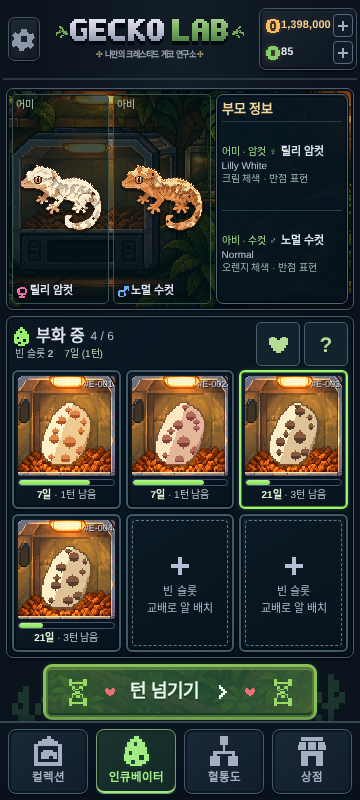

# 인큐베이터 부모 보기와 모바일 화면

알·새끼 이미지는 **선택**, 슬롯 아래 버튼은 **수령·제거**입니다. 선택만으로 게임 데이터를 변경하지 않습니다. 어미는 왼쪽, 아비는 오른쪽이며 실제 `individuals` 기록과 기존 `Sprite`를 사용합니다. 이름·성별·모프·관찰 가능한 외형만 표시하고 숨은 유전형을 추가 공개하지 않습니다. 부모 그림을 누르면 기존 개체 상세 창이 열립니다.

선택 전에는 기본 인큐베이터 장면과 안내가 표시됩니다. 부모가 판매·폐사했어도 같은 ID의 보존 기록으로 조회합니다. 누락된 부모는 정보 없음으로 처리합니다. 알의 부모 ID를 우선하고, 이전 배아에 ID가 없으면 연결된 교배 기록을 조회하며 부모를 새로 만들지 않습니다.

## 화면 구성과 높이

- 기존 공통 헤더·턴 버튼·하단 탭의 컴포넌트와 좌표를 유지합니다. 인큐베이터 중앙 영역만 수정했습니다.
- 뒤로가기/제목 행, 하단 교배·오늘 버튼 행, 부화 결과 목록을 제거했습니다.
- 부모 패널과 3열×2행 슬롯을 중앙 영역의 가용 높이에 맞는 Grid/Flex로 배분합니다. 그림은 각 영역에 맞춰 비율을 유지합니다.
- 실제 슬롯이 6개를 초과할 때만 이전/다음 페이지를 표시합니다. 실제 수용량을 넘어 가짜 빈 슬롯을 생성하지 않습니다. 페이지를 바꾸면 선택을 해제합니다.
- 44px 이상의 선택·수령·제거 버튼 영역을 확보하고, 긴 이름·모프는 줄임 처리합니다. 전체 내용은 부모 그림의 기존 상세 창에서 볼 수 있습니다.
- 교배 진입은 슬롯 헤더의 하트 버튼에, 기존 교배·산란/유전 추론 기록과 오늘의 연구소 진입은 `?` 창에 보존했습니다.
- 안전 영역은 기존 공통 레이아웃을 따릅니다. 가로 화면·큰 안전 여백처럼 공간이 아주 부족하면 중앙 영역만 스크롤하고 헤더·턴 버튼·하단 탭은 고정합니다. 중앙 최소 높이는 기본 406px, 페이지 버튼이 있으면 454px입니다.

## 보존한 게임 규칙

저장 v10과 모든 게임 엔진 파일은 변경하지 않았습니다. 교배당 2알/2칸 예약, 알 수거 후 4턴 판정, 무정란·부화 실패·유전적 비생존의 기존 결과, 수동 새끼 수령/실패 알 제거, 턴 진행, 실제 부화 턴부터의 나이 계산을 유지합니다. 인큐베이터 새끼는 기존 공통 성장 배율 50%를 한 번만 적용한 부화 당시 모습입니다.

## 검증

타입 검사·프로덕션 빌드·PNG/런타임 아트 해시 검사, 단위 **306개**, Chromium 모바일/PC E2E **208개**가 모두 통과했습니다(11.4분). 기존 테스트를 삭제하거나 건너뛰지 않았습니다.

검증 명령: `npm run typecheck`, `npm test`, `npm run build`, `node scripts/compile-gecko-art.mjs --check`, `npm run test:e2e -- --workers=2`. 이 환경의 Playwright Chromium은 `PLAYWRIGHT_BROWSERS_PATH=/tmp/gecko-ci-browsers`를 사용했습니다.

Chromium의 실제 모바일 터치/PC 마우스로 검사했습니다. 부모 전환, 원본 렌더러와 부모 Canvas 픽셀 일치, 판매 기록 조회, 8개의 실제 미처리 알·새끼 페이지 이동, 선택의 저장 불변성, 부화·수령·실패 제거 및 중복 입력, 기존 50/75/100% 성장 배율을 회귀 검사합니다. 공통 UI 좌표·안전 영역·다른 탭 테스트도 유지합니다.

기본 6칸 화면의 중앙 영역 실측:

| 화면 | 중앙 영역 | 콘텐츠 높이 | 세로 넘침 |
| --- | ---: | ---: | --- |
| 360×640 | 417px | 417px | 없음 |
| 360×800 | 574px | 574px | 없음 |
| 390×844 | 607px | 607px | 없음 |
| 430×932 | 678px | 678px | 없음 |

[측정 JSON](incubator-parents/geometry.json). 실제 휴대폰 실기 테스트는 수행하지 않았으며 Chromium 모바일 뷰포트와 터치 에뮬레이션 결과입니다.

## 캡처

[360×640](incubator-parents/parents-360x640.png) · [390×844](incubator-parents/parents-390x844.png) · [430×932](incubator-parents/parents-430x932.png)

[부화 완료 새끼·무정란의 독립 선택/처리 버튼](incubator-parents/newborn-430.png)

[알 선택 전 안내 화면](incubator-parents/unselected-390.png)

## 주요 파일

- `src/components/hardcore/incubator.tsx`: 선택·페이지·개별 처리 버튼, 간결한 슬롯 화면.
- `src/components/hardcore/incubator-parents.tsx`: 기존 기록 조회와 부모 외형·정보 패널.
- `src/app/reference-incubator.css`: 인큐베이터 중앙 영역의 높이·배치·터치 영역.
- `public/sw.js`: UI 캐시 버전 갱신.
- `tests/incubator-parents.test.ts`, `e2e/incubator-parents.spec.ts`: 기록 조회·실제 브라우저 검증. 기존 회귀 테스트는 변경된 화면 진입점과 수령/선택 분리에 맞춰 유지합니다.
