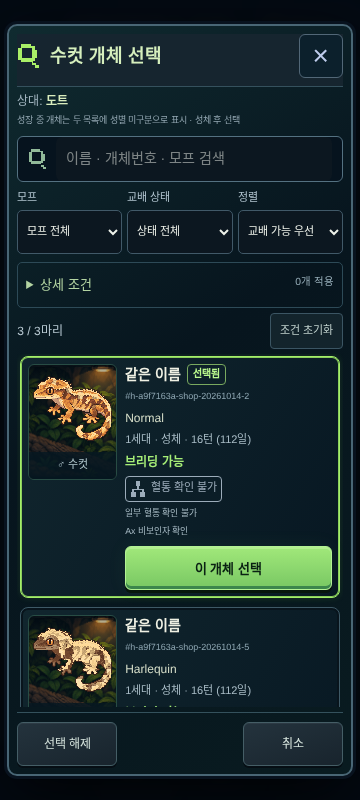
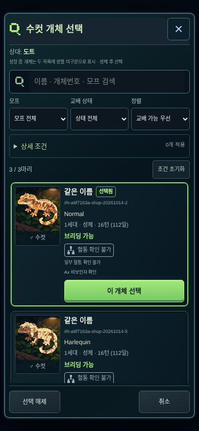
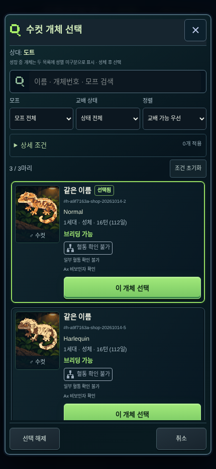
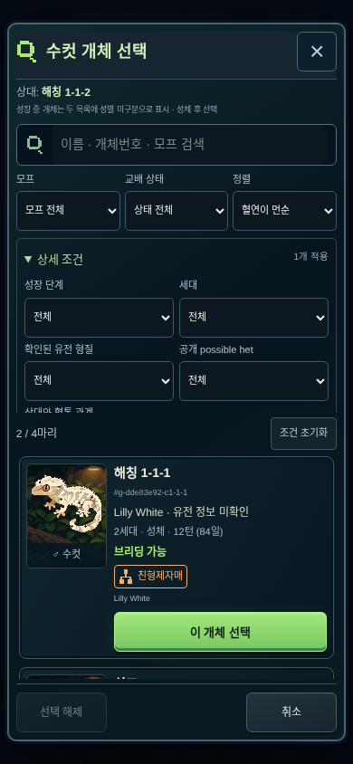

# 교배 개체 선택과 혈통 조건 검색

기존 교배 팝업 위에 성별별 개체 검색 팝업을 표시합니다. 이름·ID·관찰된 모프와 한국어 별칭을 검색하고 여러 조건을 함께 적용합니다. 실제 성체 성별로 목록을 나누되, 성체 전 성별 비공개 정책에 따라 성장 중 개체는 두 목록에 **성별 미구분 / 성체 후 선택 가능**으로 표시합니다.

## 선택과 공개 정보

- 개체 변경 → 검색 → 선택 시 해당 성별 슬롯만 ID로 갱신합니다. 상대 슬롯은 유지하며 자동 교배는 실행하지 않습니다.
- 취소·닫기·Escape는 기존 선택을 유지합니다. 공통 Dialog의 cancel 전파를 막아 상위 교배창이 함께 닫히는 문제를 해결했습니다.
- 확인된 유전 형질과 possible het는 기존 `publicKnowledge` 확률만 사용합니다. 숨은 유전체·건강 좌위로 검색하거나 정렬하지 않습니다. possible het는 현재 게임이 공개 확률을 제공하는 Axanthic을 지원합니다.
- 기본 외형/한국어 무늬와 관찰된 Cappuccino/Sable/Highway 계열을 모프 조건으로 제공합니다. 복합 모프 필터 역시 이미 표시되는 모프 명칭으로 선별하며 비공개 대립유전자를 조회하지 않습니다.
- 성장/휴식/산란 대기/교배 대기/은퇴/공간 부족은 기존 게임 데이터로 계산합니다. 하트 1~2인 생존 개체는 엔진에서 교배를 허용하므로 관리 권장을 별도로 표시하며 임의의 제한을 추가하지 않습니다.
- 성체의 불가 사유는 확인할 수 있고 선택도 가능합니다. 실제 교배 실행 가능 여부와 통합 위험 확인은 기존 `breedingCheck`·`breedingRisk`·`startMating`이 결정합니다. 혈연 때문에 후보 선택을 차단하지 않습니다.

## 혈통 판정

`src/game/relative-search.ts`는 모든 individuals의 부모 ID를 사용합니다. 보유 여부·이름·모프·숨은 유전형은 관계 계산에 관여하지 않습니다. 판매·폐사·외부 부모도 같은 기록으로 포함합니다.

| 표시 | 기준 |
| --- | --- |
| 부모 ↔ 자식 | 직접 부모 ID 연결 |
| 친형제자매 / 이복형제자매 | 동일한 두 부모 / 한 부모 공유 |
| 조부모 ↔ 손자녀 | 직접 조상 거리 2 |
| 삼촌·고모·이모 ↔ 조카 | 한쪽이 상대 부모의 형제자매(이복 포함) |
| 사촌 | 양쪽 부모가 형제자매(이복 포함) |
| 직계 조상 ↔ 후손 / 먼 공통 조상 | 더 먼 직계 또는 공통 조상 경로 |
| 기록상 공통 조상 없음 | 양쪽 부모가 기록되어 있고 참조 누락·순환 없이 탐색했으나 공통 조상 없음 |
| 혈통 확인 불가 | 부모 미등록·참조 누락·순환 또는 상대 기록 없음 |
| 상대 선택 대기 | 반대 슬롯 미선택 |

여러 관계가 겹치면 최소 연결 거리의 관계를 먼저 표시하고 다른 확인된 관계를 덧붙입니다. 부모 한 자리만 알려진 형제는 친/이복 여부를 확정하지 않습니다. 누락이 있어도 확인 가능한 가까운 관계는 유지하면서 불완전함을 알립니다. 기록상 공통 조상 없음은 실제 비혈연을 보증하지 않습니다. 혈연 정렬은 그래프 거리이며 F나 질병 확률이 아닙니다. 불완전하거나 미확인인 기록은 먼 혈연으로 우선하지 않고 뒤에 배치합니다.

불변 individuals 객체별 그래프를 캐시하고 상대를 바꿀 때 부모 우선 순서로 공통 조상 거리·직계 경로를 한 번 계산합니다. 상대당 O(V+E), 후보별 상수 크기 부모/조부모 조회입니다. 재귀와 후보별 F 행렬 계산을 사용하지 않습니다. 10,000개 장기 혈통 테스트를 포함합니다. UI는 필터 전 후보/상태를 메모하고 스프라이트를 24개 단위로 추가 표시합니다. 기존 개체 렌더러와 외형 시드는 그대로 사용합니다.

최근 획득순은 기존 individuals의 저장된 등록 순서입니다. 새로운 획득 시각이나 저장 필드를 만들지 않습니다. 백업/IndexedDB 복원은 이 순서를 보존합니다. 저장 v9·규칙 버전 4와 기존 마이그레이션을 변경하지 않았습니다.

## 모바일 캡처

실제 프로덕션 빌드의 Chromium 터치 화면입니다. 테스트용 명시적 저장 자료를 UI의 JSON 복원으로 불러왔으며 플레이어의 새 게임에는 설치하지 않습니다.

| 360×800 | 390×844 | 430×932 |
| --- | --- | --- |
|  |  |  |

관계 캡처의 [검토용 백업](parent-search/review-save.json)은 기존 엔진으로 교배·부화·12턴 성장시킨 가족입니다. 새끼들의 부모 ID와 유전 결과를 편집하지 않았습니다. 검색 팝업은 숨은 유전 정보를 표시하지 않지만 JSON 백업 자체는 원본 게임 데이터를 포함합니다.

## 검증

- 단위: 친/이복 형제, 부모, 조부모, 삼촌·조카, 사촌, 원거리, 중첩 경로, 참조 누락, 순환·10,000개 혈통, 불완전 혈통 정렬, 판매·사망 조상, 상대 변경을 검증합니다.
- 공개 정보: 숨은 AA/Aa만 바꾸어도 공개 태그·검색·필터·정렬 결과가 동일한지 확인합니다. 확인된 형질과 공개 possible het의 복합 필터도 검증합니다.
- 게임: 기존 실제 턴으로 성장/휴식 2→1→완료, JSON 복원 전후 후보와 기록 일치, 조회의 비변경성을 확인합니다.
- 브라우저: PC/모바일에서 성별 구분·성별 미구분 성장 개체·선택 표시·다른 슬롯 보존·취소/Escape·복합 조건·빈 결과 초기화·다음 턴/새로고침·근친 경고를 실제 UI로 확인합니다. 기존 회귀 테스트도 새 검색창을 통해 부모를 선택합니다. `/lab/breeding`의 이전 Phase 2 native select 테스트는 유지합니다.
- 모바일 360·390·430px에서 가로 넘침, 팝업/스크롤 영역, 44px 선택/취소 터치 영역, 픽셀 스무딩 비활성화와 브라우저 오류를 확인합니다.

실물 iOS/Safari는 검증하지 않았습니다. 근교계수·위험 계산 및 기존 위험 모델의 가정은 [기존 기록](breeding-risk.md)을 따릅니다. 표시된 혈연은 등록된 기록 범위의 관계이며 누락된 조상이나 실제 생물학적 관계를 추정하지 않습니다.

## 주요 파일

- `src/game/relative-search.ts`: 재사용 가능한 혈통 검색 인덱스·관계 분류·거리 정렬.
- `src/components/hardcore/parent-search-query.ts`: 공개 유전 태그·후보·복합 필터·정렬.
- `src/components/hardcore/parent-search.tsx`, `src/app/parent-search.css`: 독립적으로 스크롤하는 검색 팝업.
- `src/components/hardcore/breeding.tsx`: 기존 부모 카드의 변경 버튼 및 ID 전달.
- `src/components/hardcore/collection-status.ts`: 기존 상태 판정 재사용과 일괄 조회 컨텍스트. 컬렉션 UI와 상태 우선순위 유지.
- `src/components/game/common.tsx`: 중첩 팝업 cancel 이벤트 격리.
- `tests/relative-search.test.ts`, `tests/parent-search.test.ts`, `e2e/parent-search.spec.ts`: 기능·보호·모바일 검증.

타입 검사·프로덕션 빌드·아트 해시 검사, 전체 단위 **22파일 / 257개**, 전체 E2E **154개**를 통과했습니다. 마지막 복합 모프 필터·검색 캐시 추가 뒤에는 관련 E2E **14개**를 다시 실행해 모두 통과했습니다. [검증 요약](parent-search/validation.json)과 README에도 결과를 기록합니다.
