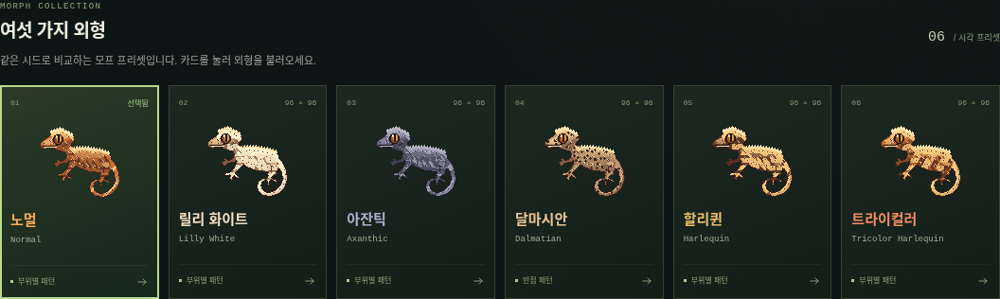
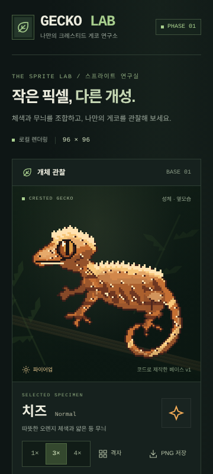

> Phase 2에서는 이 연구실을 `/lab`에서 유지합니다. 아래는 Phase 1 구현과 당시 검증 기록입니다.

# GECKO LAB — Phase 1

크레스티드 게코의 **96×96 픽셀 스프라이트 렌더링 엔진**과 한국어 모바일 테스트 화면입니다.
Next.js 16, React 19, TypeScript, Tailwind CSS 4, HTML Canvas 2D를 사용합니다.
유전학·교배·육성 로직은 구현하지 않습니다. 실행 중 외부 API, 외부 폰트, 비밀 키를 사용하지 않습니다.

## 디자인과 현재 품질

- `references/gecko-morph-concept.png`: 노멀, 릴리 화이트, 아잔틱, 달마시안, 할리퀸, 트라이컬러의 외형 목표.
- `references/gecko-mobile-ui.png`: 세로 화면, 어두운 서식지, 녹색 강조색, 개체 카드의 참고 자료.

원본 레퍼런스는 변경하거나 스프라이트로 잘라 사용하지 않았습니다.
`src/engine/base.ts`에 직접 설계한 실루엣, 부위 마스크, 명암, 크레스트, 발가락 패드, 눈과 꼬리 디테일을 래스터화합니다.
**이 베이스는 코드로 제작한 첫 번째 프로토타입이며, 콘셉트아트와 같은 품질을 구현했다고 주장하지 않습니다.**
목과 관절의 볼륨, 발가락의 형태, 미세한 비늘과 무늬 가장자리의 유기성은 더 다듬어야 합니다.

## 실행

Node.js 24 LTS 권장(22 이상), npm, Canvas 2D를 지원하는 브라우저가 필요합니다.
고정된 의존성은 `package-lock.json`으로 설치합니다.

```sh
cd /workspace/gecko-lab
npm ci
npm run dev
```

개발 서버 기본 포트는 3000입니다. 일반 로컬 체크아웃에서는 해당 저장소 디렉터리에서 같은 명령을 실행하세요.
모바일 우선 레이아웃과 safe-area 여백을 적용했습니다. 클라우드 작업에서는 기존 체크아웃을 사용하고 별도의 Git worktree를 만들지 않습니다.
개발 리소스는 localhost와 로컬 검사에 쓰는 127.0.0.1만 허용합니다. 다른 터널이나 LAN 호스트를 쓰려면 해당 호스트를 Next.js의 `allowedDevOrigins`에 명시하세요.

프로덕션 실행:

```sh
npm run build
npm run start
```

## 테스트 화면

- Orange / Brown / Cream 및 아잔틱 비교용 Slate 체색.
- 등·옆구리 패턴 면적, 달마시안 반점 0~70개, 파이어업 / 파이어다운.
- 입력으로 적용하는 고정 시드. 같은 엔진 버전·시드·파라미터는 같은 RGBA를 생성합니다.
- 같은 시드를 공유하는 여섯 모프 프리셋 갤러리와, 같은 외형 설정을 가진 서로 다른 시드의 개체 3종 비교.
- 8개 레이어 개별 표시, 배경 격자, 1× / 3× / 4× 확대, 투명 96×96 PNG 저장.
- 좁은 화면의 4× 확대는 **캔버스 영역 안에서** 가로 스크롤합니다. 페이지 자체는 넘치지 않습니다.

프리셋 이름은 **시각적 목표**입니다. 실제 모프 유전 여부나 생물학적으로 가능한 교배 결과를 판정하지 않습니다.
슬라이더의 면적은 패턴 형상의 성장 파라미터이며 전체 불투명 픽셀 대비 면적 백분율과 정확히 같지는 않습니다.

## 엔진 구조

```text
src/
├── app/                 Next.js 화면, 전역 스타일, PWA 매니페스트
├── components/          한국어 테스트 UI, Canvas 어댑터 사용 컴포넌트
└── engine/
    ├── model.ts         버전이 있는 개체 데이터, 레이어 타입, 파라미터 검증
    ├── base.ts          직접 설계한 고정 96×96 베이스와 부위 마스크
    ├── raster.ts        정수 픽셀 도형, 색 혼합, 마스크 교집합
    ├── random.ts        시드와 패턴 종류별 결정적 난수 스트림
    ├── presets.ts       외형 비교용 프리셋 6종
    ├── render.ts        부위별 패턴 생성과 알파 마스크 합성
    └── canvas.ts        브라우저 전용 Canvas 2D 출력
public/                  로컬 앱 아이콘
tests/                   DOM이 필요 없는 엔진 테스트
e2e/                     실제 Chromium 기능·모바일 검사
scripts/                 로컬 PWA 아이콘 재생성
references/              수정하지 않은 디자인 레퍼런스
```

레이어 순서: 기본 실루엣 → 기본 체색 → 그림자 → 하이라이트 → 등 패턴 → 옆구리 패턴 → 반점 → 눈·크레스트·꼬리 디테일.
각 레이어는 RGBA 버퍼와 별도의 8비트 알파 마스크를 가집니다.
합성 시 픽셀 알파와 마스크 알파를 곱한 뒤 source-over 방식으로 조합합니다.
모든 출력은 실루엣에 제한되고, 패턴 색에도 부위의 명암을 반영합니다.

등 무늬는 척추 윤곽을 따르고 옆구리 무늬는 배에서 등으로 뻗는 가지 형태를 사용합니다.
반점은 눈·크레스트·외곽선을 피해 부위 마스크 안에 간격을 두고 배치합니다.
픽셀마다 무작위 노이즈를 뿌리는 방식이 아닙니다.
패턴별 난수 스트림을 분리해 체색·발색 변경 시 무늬 위치가 유지되며, 면적과 반점 수를 늘려도 기존 패턴을 유지합니다.

`GeckoSpecimen.appearance`는 미래 유전학 엔진이 공급할 수 있는 외형 데이터입니다.
시드와 ID는 개체 정보, `state.fire`는 일시적인 발색 상태로 분리합니다.
현재 스키마는 v1, 렌더링 규칙은 엔진 v1.0.0입니다. 향후 알고리즘이 바뀌면 엔진 버전과 시각 회귀 기준을 함께 갱신해야 합니다.

Canvas를 사용하지 않는 엔진 호출 예시:

```ts
import { MORPH_PRESETS, specimenFromPreset } from "./src/engine/presets";
import { renderSprite } from "./src/engine/render";

const specimen = specimenFromPreset(MORPH_PRESETS[0], "GECKO-0014");
specimen.appearance.spotCount = 30;
const result = renderSprite(specimen);
// result.pixels: 96×96 RGBA, result.layers: 8개의 독립 레이어
```

`canvas.ts`만 DOM에 의존합니다. 96×96 버퍼를 먼저 그리고
`imageSmoothingEnabled = false`로 정수 배율 확대하며 CSS `image-rendering: pixelated`도 적용합니다.
레퍼런스 파일은 실행 시 다운로드하지 않습니다.

## 검증

```sh
npm run typecheck
npm test
npm run build
npx playwright install chromium
npm run test:e2e
```

이 클라우드 환경에는 시스템 Chromium이 있으므로 추가 브라우저 다운로드 없이 다음 명령을 사용할 수 있습니다.

```sh
PLAYWRIGHT_CHROMIUM_EXECUTABLE_PATH=/usr/bin/chromium npm run test:e2e
```

### 로컬 검증 결과 — 2026-10-13

| 검사 | 결과 | 확인 범위 |
| --- | --- | --- |
| `npm ci` | 통과 | lockfile 그대로 재설치 |
| `npm run typecheck` | 통과 | 앱·엔진·테스트의 TypeScript |
| `npm test` | 23/23 통과 | 결정성, 6종 차이, 부위 마스크, 색상·발색 독립성, 면적·반점 증가, 잘못된 입력, 알파 합성 |
| `npm run build` | 통과 | 프로덕션 빌드와 정적 페이지 생성 |
| Playwright Chromium | 12/12 통과 | 360×800 모바일, 1280×900 데스크톱 각각 6개 검사 |
| 개발 서버 브라우저 요청 | 통과 | 360px, 288×288 Canvas 출력, 스무딩 OFF, 가로 넘침·브라우저 오류 없음 |

브라우저 검사에서는 모든 3×/4× 픽셀을 논리 RGBA와 비교하고 스무딩 비활성화를 확인했습니다.
360px의 기본·4× 화면 가로 넘침, 여섯 프리셋의 서로 다른 출력, 조작 후 같은 시드 재현,
레이어 전체 숨김·복원, 로드 후 오프라인 렌더링, 96×96 PNG 저장, 로컬 매니페스트·아이콘 응답을 검증했습니다.
건너뛰거나 비활성화한 테스트는 없습니다.





GitHub Actions는 PR과 main 푸시에 타입 검사, 엔진 테스트, 빌드와 브라우저 검사를 실행합니다.
CI에서는 Playwright Chromium과 시스템 의존성을 설치합니다. 위 결과는 현재 클라우드 인스턴스에서 수행한 로컬 결과이며, GitHub CI 결과는 별도로 확인해야 합니다.

## PWA와 미완성 항목

- 세로 방향 standalone 매니페스트, 192/512 PNG 아이콘, iOS 메타데이터와 safe-area를 준비했습니다.
  아이콘은 `node scripts/generate-icons.mjs`로 로컬 재생성할 수 있습니다.
- 로드가 끝난 화면의 렌더링과 PNG 저장에는 네트워크가 필요 없습니다.
  **서비스 워커·오프라인 재접속 캐시·설치 흐름은 미구현**입니다. 완전한 오프라인 PWA라고 주장하지 않습니다.
- Safari/iOS와 실제 스마트폰 기기 검사는 아직 수행하지 않았습니다. 자동 검증 대상은 Chromium입니다.
- 하나의 성체 옆모습만 있습니다. 애니메이션·성장 단계·다른 자세·개체 영구 저장은 미구현입니다.
- 전문 픽셀 아티스트의 96×96 베이스와 부위별 알파 마스크를 추가하고,
  동일한 입력/레이어 계약으로 교체하는 것이 다음 시각 품질 개선 단계입니다.
- 유전학·브리딩·인큐베이터·혈통도·재화 시스템은 이번 단계 범위에 없습니다.

## PR 개발

기능 브랜치에서 변경을 만들고 위 검사를 통과시킨 뒤 main 대상 PR로 리뷰합니다.
PR에는 동작 변화, 테스트 결과, 화면 캡처와 남은 시각적 한계를 기록합니다.
