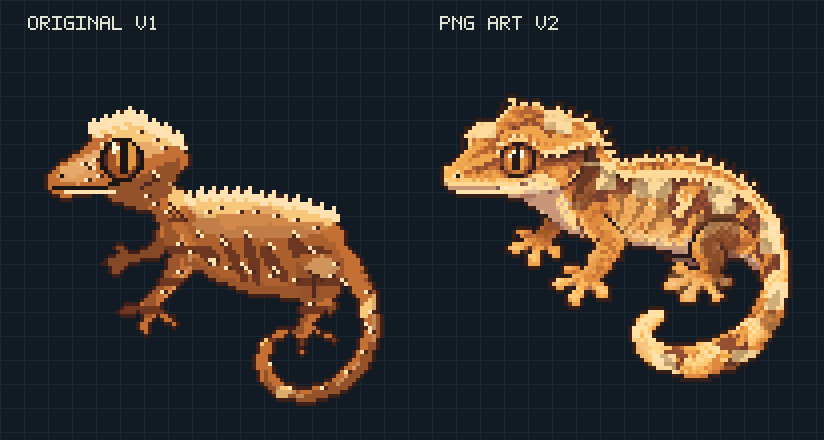
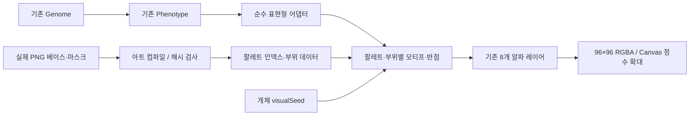
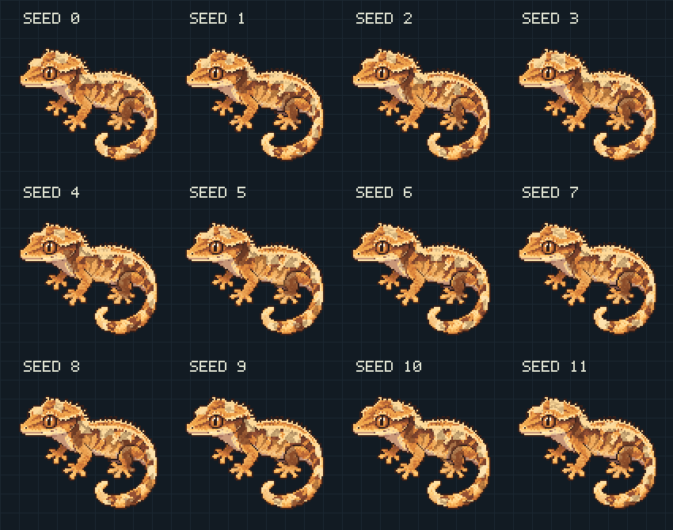
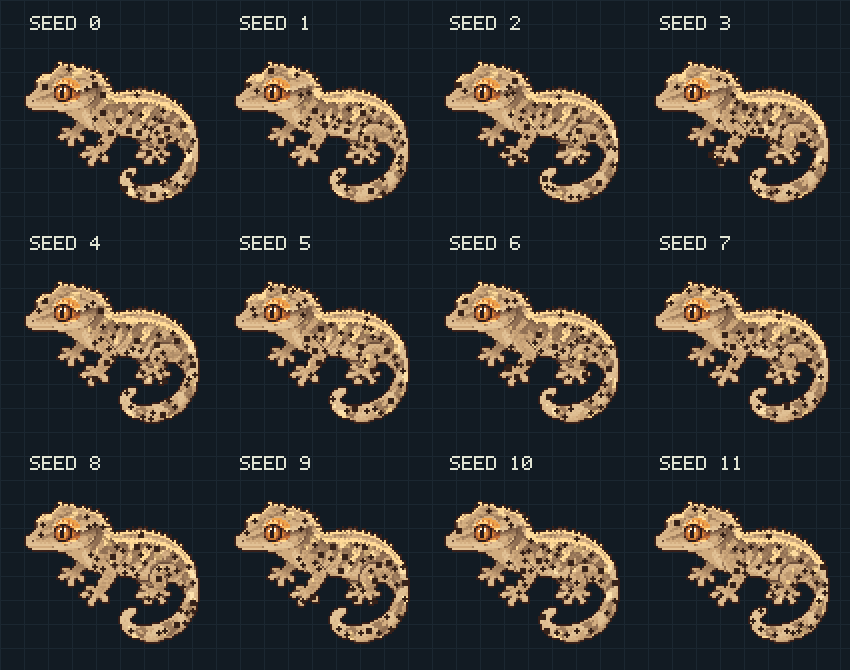
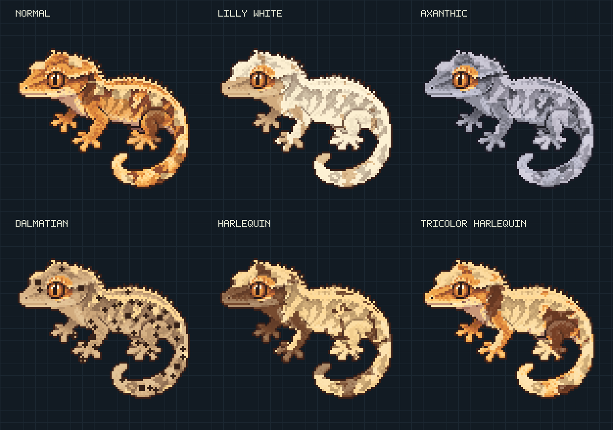
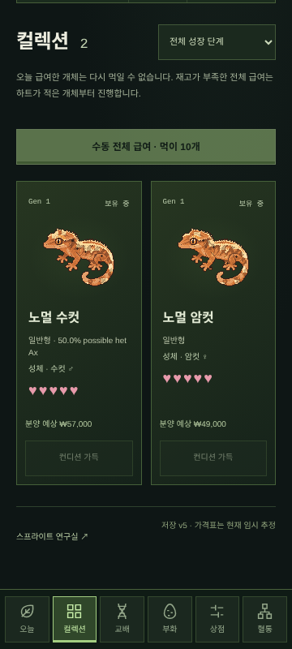
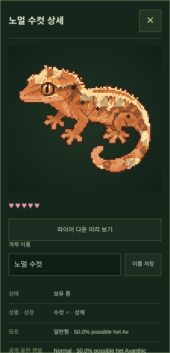
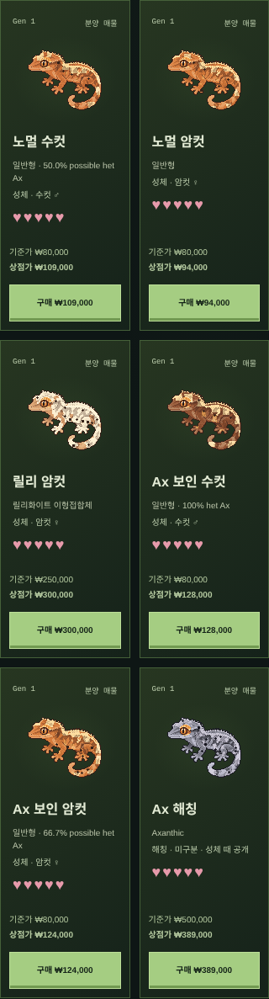
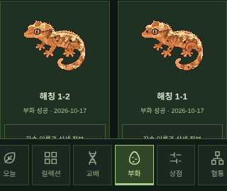
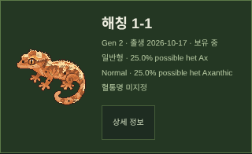

# Phase 6 — PNG 기반 픽셀 아트 개선

검토 날짜: **2026-10-14**. 렌더러 **1.0.0 → 2.0.0**, 게임 저장 **v5 / 규칙 v2 / 기존 유전 모델 유지**.

## 실제 전후 비교



같은 `phase6-comparison` 시드와 기존 Normal 프리셋으로 실제 `renderLegacySprite` / `renderSprite` RGBA 출력을 비교했습니다. 레퍼런스 이미지를 결과로 재사용하지 않습니다. 4배 확대는 각 논리 픽셀을 정확히 4×4로 복제하며, 비교 도표의 글자·배경 격자는 출력 바깥에만 그립니다.

| 구분 | 96×96 실제 출력 | 4배 실제 출력 |
| --- | --- | --- |
| 이전 | [Normal v1](phase6/normal-v1-96.png) | [Normal v1 384px](phase6/normal-v1-384.png) |
| 개선 | [Normal v2](phase6/normal-v2-96.png) | [Normal v2 384px](phase6/normal-v2-384.png) |

기존 베이스는 좁은 목, 긴 전완, 가느다란 발가락, 각진 관절과 균일한 무늬가 눈에 띄었습니다. 새 베이스는 넓은 머리와 도톰한 몸통, 짧고 굽은 다리, 눈꺼풀·턱·크레스트, 두꺼운 둥근 꼬리로 바꿨습니다. 얼굴과 실루엣은 모든 시드에서 그대로 유지하며 무늬만 변화합니다.

## 원화와 실제 아트 자산

핵심 비주얼 레퍼런스 `references/gecko-morph-concept.png`와 모바일 UI 원본을 모두 검토했습니다. 원본은 수정하지 않았습니다. 이미지 생성 도구로 **별도의 Normal 원화**를 생성하고 논리 픽셀 및 팔레트와 부위별 PNG 마스크로 정리했습니다. 기존 다각형을 PNG로 저장한 자산이 아닙니다.

[아트 폴더](../public/art/gecko-v2/)에는 다음 파일을 포함합니다.

| 자산 | 역할 |
| --- | --- |
| `source-art.png` | 별도 생성 원화. **1312×1199**, 게임 최종 출력이나 native 96px 작품으로 주장하지 않음 |
| `normal-base.png` | 실제 **96×96**, 사용 색 26개, 이진 투명도. 원화의 논리 픽셀 표본과 제한 팔레트로 정리한 베이스 |
| `parts.png` | 원화 위에 주석을 단 꼬리·먼 다리·몸통·머리·앞다리·뒷다리 6부위 |
| `outline.png` | 실제 베이스 알파에서 정리한 1픽셀 외곽선 보호 영역 |
| `shadow.png`, `highlight.png` | 원화의 명암 클러스터 영역. 무작위 점 질감이 아님 |
| `crest.png`, `face.png` | 크레스트 및 눈·얼굴·입 보호 영역 |
| `dorsal.png`, `flank.png`, `spots.png` | 무늬를 그릴 수 있는 부위별 제한 영역 |
| `manifest.json` | 원화 해시, 논리 표본 범위, 팔레트와 주석, 처리 방식·한계 기록 |

새 실루엣은 PNG의 3,085개 불투명 픽셀에서 가져옵니다. 부위 주석용 다각형은 **이미 존재하는 아트 픽셀의 영역만 분류**하며 동물 형상을 생성하지 않습니다. 런타임은 PNG에서 컴파일한 팔레트·인덱스 픽셀·마스크를 사용합니다. 이미지 파일을 장식으로 넣고 구버전 좌표를 계속 그리는 방식이 아닙니다.

원화는 이미지 생성 도구의 결과이며 전문 픽셀 아티스트가 96픽셀씩 수작업한 작품으로 주장하지 않습니다. 원화의 정교한 질감은 96픽셀에서 줄어듭니다. 기술적인 최근접 표본화, 명시 팔레트와 영역 주석은 생성 원화와 구분된 준비 과정입니다.

## 렌더링 구조



`src/engine/art-data.ts`는 실제 PNG에서 생성한 데이터입니다. `compile-gecko-art.mjs --check`로 PNG와 런타임 해시·픽셀·마스크의 일치를 검사하고 CI에서도 실행합니다. 원화 처리 스크립트는 참고 이미지 파일을 열지 않습니다. 코딩·게임 실행에는 이미지 생성 API나 외부 이미지 요청이 없습니다.

기존 `GeckoSpecimen` schema 1, 96×96 결과, 8개 레이어 이름·토글·알파 조합·PNG 내보내기를 유지합니다. 내부 역할은 다음과 같이 묶습니다.

| 외부 레이어 | 새 내부 역할 |
| --- | --- |
| silhouette | 실제 PNG 알파의 형태 |
| body | 기본 체색·중간톤 클러스터 |
| shadow / highlight | 원화의 분리된 명암 픽셀 |
| dorsal | 머리/등/꼬리 모티프·핀스트라이프 보강 |
| flank | 옆구리·다리·꼬리의 부위별 무늬 |
| spots | 제한 영역의 결정적 반점 클러스터 |
| details | 외곽선·눈·얼굴·크레스트를 마지막에 보호 |

PNG 마스크 밖으로 무늬가 나가지 않으며 얼굴·눈·외곽선을 덮지 않습니다. 실제 모든 출력의 알파는 0/255이고 Canvas는 스무딩을 끕니다. 3배와 4배의 각 픽셀이 논리 RGBA와 정확히 일치하는 기존 브라우저 검사를 유지합니다.

`src/engine/legacy`에 이전 코드와 출력 버전 1.0.0을 보존했습니다. `/lab`에서 **새 아트 v2 / 이전 아트 v1**을 선택하면 같은 시드·파라미터를 비교할 수 있습니다. 정식 게임은 v2를 기본 사용합니다. 비교는 게임 데이터나 개체를 다시 생성하지 않습니다.

## 무늬의 연속성과 다양성

작게 그린 모티프 3종과 신체별 배치 지점을 사용합니다. 시드는 위치·비율·기울기·모티프를 선택하고, 강도는 같은 중심에서 무늬를 키웁니다. 원화 명암을 무늬색에 반영해 넓은 패턴이 관절을 평평하게 덮지 않도록 조정했습니다. 픽셀마다 무작위 노이즈를 뿌리지 않습니다.

20%→80% 강도에서 기존 핵심 픽셀을 보존하고 면적이 증가하는 것을 검사합니다. 반점은 독립 난수 스트림과 거리 제한으로 위치·크기를 정하며 수를 늘리면 기존 반점의 앞부분을 유지합니다. 반점 크기는 1/1.7 논리 픽셀 반경의 렌더러 규칙입니다. 기존 유전 엔진에 `spotSize` 유전자가 있는 것처럼 추가하지 않습니다.

동일 모프·같은 주요 입력을 유지한 **12개 시드**의 Normal 및 Dalmatian을 각각 렌더링했습니다. 12개 결과 해시가 모두 다르면서 형태·명암·얼굴 레이어는 동일합니다. 도표는 2배 정수 복제입니다.




같은 자세의 공유 베이스이므로 형태·일부 원화의 기본 표면 특징은 반복됩니다. 시드는 유전형이나 희귀 모프를 바꾸지 않습니다.

## 여섯 모프의 실제 갤러리



프리셋의 이름·분류·주요 수치를 바꾸지 않았습니다. Normal은 따뜻한 오렌지/브라운, Lilly는 넓은 크림, Ax는 저채도 슬레이트, Dalmatian은 반점, Harlequin은 밝은 측면/다리, Tricolor는 따뜻한 체색·짙은 무늬·크림의 대비로 표현합니다. 새 이미지 6장을 골라 고정 출력하지 않고 모두 하나의 베이스와 가변 패턴을 사용합니다.

## Phase 5 연결과 저장 호환

`hardcore/adapter.ts`가 기존 `phenotype(genome)`을 호출하고 이미 존재하는 점수만 아트 입력에 옮깁니다.

| 기존 점수 | 렌더링 연결 |
| --- | --- |
| red / orange / brightness | 팔레트의 적색·오렌지·명도 보정 |
| cream / dorsal | 등 패턴 면적·크림 발색 |
| flank / harlequin | 측면 및 다리 패턴 |
| spots | 기존 spotCount, 위치·크기는 고유 시드 |
| pinstripe | 등선 주변 연속성 보강 |
| contrast | 바탕·패턴 대비 |
| fire state | 색 변화만, 무늬 위치와 유전형 유지 |

신규 `appearance.expression`은 렌더링용 선택 입력이며 유전자/저장 필드가 아닙니다. 없으면 기존 6개 외형 파라미터만으로 작동합니다. `spotSize`, 눈색 유전자, 새 성장 규칙 등은 발명하지 않습니다.

저장 버전은 **v5 그대로**입니다. 유전형·부모·혈통·ID·고유 시드·턴·하트·돈·판매·알·개체를 변경하지 않습니다. v2/v3/v4 이전은 기존 경로를 유지하고 아트는 저장된 표현형을 읽어 v2 스타일로 표시합니다. 예전 문서의 “픽셀 보존”은 Phase 5 이전 당시 계약이며 **이번 요청에서는 기존 개체의 시각 스타일 변경이 허용**되어 default renderer를 바꿨습니다. 원래 픽셀 비교는 legacy renderer로 유지됩니다.

유전 엔진, 교배 확률, 근친/위험 정책, 시간 방식, 생존 규칙, 경제·상점·가격표는 변경하지 않았습니다. PWA 화면 캐시 버전만 갱신하며 IndexedDB를 지우지 않습니다.

## 실제 모바일 게임 캡처

360×800 Chromium 터치에서 실제 게임을 실행했습니다. 기본 50만원으로 Normal 한 쌍과 먹이를 구매했고, 검사 JSON의 수정/부화 확률만 100%로 고정해 같은 결과 경로를 확인했습니다. 일반 새 게임은 기존 90%/90%입니다.







컬렉션은 360×800 원본, 상세·상점·부화·혈통은 해당 UI 영역의 원본 캡처이며 편집된 콘셉트 이미지가 아닙니다. 캔버스의 얼굴·몸체가 보이고 스무딩이 꺼진 상태, 정수 픽셀 크기와 화면 폭을 검사합니다.

## 검증·재현 명령

```sh
# PNG를 편집한 경우에만 원본과 마스크를 검토한 뒤 컴파일
node scripts/compile-gecko-art.mjs
# 배포/검증 시 생성 코드의 최신 여부만 검사
node scripts/compile-gecko-art.mjs --check
# 실제 두 렌더러의 PNG·원시 해시 도표 재생성
node scripts/render-art-report.mjs
npm run typecheck
npm test
npm run build
PLAYWRIGHT_CHROMIUM_EXECUTABLE_PATH=/usr/bin/chromium npm run test:e2e
```

`prepare-gecko-art.mjs`는 원화에서 베이스와 주석을 다시 만드는 제작용 단계입니다. 아티스트가 PNG를 수정했으면 이 스크립트를 무조건 실행해 덮어쓰지 말고 편집 PNG를 컴파일합니다. [render-report.json](phase6/render-report.json)에 정확한 시드·프리셋·버전·RGBA 해시와 출처를 보관합니다. 최종 타입·단위·빌드·모바일 검사 결과는 README에 기록합니다.

## 아직 부족한 부분

- 레퍼런스 수준의 전문 수작업 96px 아트로 완성했다고 주장하지 않습니다. 원화에 비해 미세 피부 질감과 부드러운 얼굴선이 줄어듭니다.
- 발가락 패드를 압축해서 표현해 다섯 발가락 모두를 명확히 그리지는 못했습니다. 일부 포즈/관절은 원화의 단순화가 남습니다.
- 단일 공유 자세·형태·기본 표면 특징으로부터 변형합니다. 더 많은 포즈, 성장별 그림, 전용 눈/구조 변이는 없습니다.
- 핀스트라이프는 기존 등 레이어로 보강하며 완전히 독립된 전문 핀스트라이프 아트는 아닙니다.
- C/S/H 전용 아트와 근거 없는 유전형 추가는 없습니다. 실제 iOS/Safari 기기와 전문 픽셀 아티스트의 별도 품질 평가는 미완료입니다.
- JSON 백업과 개체 정체성은 유지되지만 스타일 업그레이드로 기존 개체의 보이는 색·무늬는 바뀝니다. 구버전 비교는 연구실에서 가능합니다.
