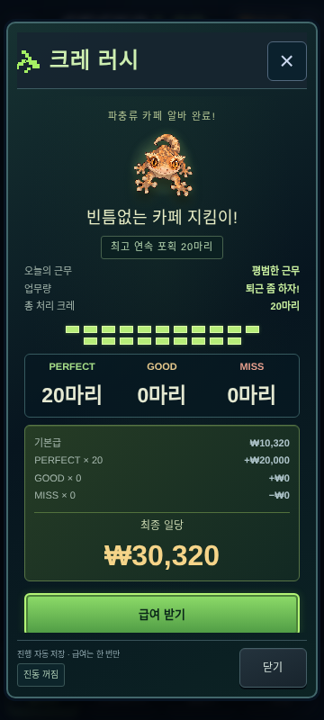

# 크레 러시 v3 — 랜덤 업무량과 비밀 퇴근

신규 근무는 시작할 때 난이도, 업무량 구간, 실제 마릿수, 전체 웨이브를 확정합니다. 근무 중에는 현재 웨이브 번호·처리 수·현재 일당만 표시합니다. 총량·남은 수·총 웨이브·남은 시간·전체 진행률과 업무량 구간은 공개하지 않습니다. 마지막 판정 이후에만 650ms 퇴근 인사를 거쳐 결과에서 실제 근무와 업무량을 공개합니다.

## 추첨과 배치

`src/game/rush-shifts.ts`에 v3 설정을 모았습니다.

| 업무량 | 범위 | 설정 확률 | 1,000,000회 관측 |
|---|---:|---:|---:|
| 한가한 매장 | 6~8 | 25% | 24.9643% |
| 평소처럼 | 9~12 | 35% | 34.9787% |
| 손님이 많네? | 13~16 | 25% | 24.9940% |
| 퇴근 좀 하자! | 17~20 | 15% | 15.0630% |

구간을 먼저 추첨하고 구간 안의 정수 마릿수는 균등 추첨합니다. 난이도는 별도 시드 도메인으로 한가한 평일 20% / 평범한 근무 45% / 바쁜 주말 25% / 탈출 대소동 10%를 추첨합니다. 관측값은 각각 20.0475% / 44.9393% / 24.9743% / 10.0389%입니다. [전체 관측 원본](rush-secret-shifts/distribution.json)에 개별 마릿수와 4×4 교차 빈도를 남겼습니다. 단위 검사는 비율 오차·구간 내 균등성·교차 빈도와 독립된 추첨 함수를 검사합니다. 교차 빈도의 χ²는 7.6086(자유도 9)이며 0.1% 오경보 기준인 27.88보다 작습니다. 유한 시뮬레이션이 난수의 수학적 독립성을 증명하는 것은 아닙니다.

확인한 기존 코드에는 랜덤 난이도 시스템이 없었습니다. 기존 v2 비행 곡선·판정 비율을 **평범한 근무**로 보존하고, 평일/주말/대소동의 비행 시간 배율을 1.12 / 0.90 / 0.82, 웨이브 간격 배율을 1.08 / 0.94 / 0.90으로 분리했습니다. 판정의 접근 진행도 구간은 기존과 같고, 실제 허용 시간은 비행 속도에 비례합니다. 업무량은 이 배율에 관여하지 않습니다.

- 첫 두 웨이브는 한 마리, 세 번째는 두 마리입니다. 이후 한/두/세 마리를 15/45/40의 가중치로 고릅니다. 남은 수가 적으면 마지막 그룹만 잘라 총량을 정확히 맞춥니다.
- 속도 곡선은 웨이브 번호에 따라 3300 / 3100 / 3000 / 2450 / 2300 / 2250ms로 진행하고 이후에는 더 빨라지지 않습니다. 개별 ±4% 변동과 난이도 배율을 적용합니다. 긴 업무량 때문에 별도 가속하지 않습니다.
- 각 웨이브는 별도 난수 스트림을 쓰므로 같은 시드·난이도의 짧은 근무와 긴 근무의 공통 앞부분은 동일합니다. 마지막 전용 배치·예고·레이아웃 변경은 없습니다. 일반 후반 웨이브에도 한 마리가 나올 수 있습니다.
- 한 그룹은 최대 세 마리입니다. 삼각형 안전 구역과 850ms 시차를 유지하고, 다음 웨이브는 이전 판정 구간 이후에 시작합니다. 모바일 히트박스 겹침·화면 이탈·한 손가락 포획 간격을 검사합니다.
- 짧은 근무와 긴 근무의 화면 크기·HUD 위치는 같습니다. 결과 확인 전에는 같은 대기 문구를 사용합니다. 마릿수 때문에 플레이 시간은 달라지며 고정 25초 종료를 적용하지 않습니다.

## 급여와 저장 호환

새 급여는 `Math.max(0,10320+perfect*1000+good*500-miss*1500)`입니다. 업무량 수당·콤보 추가금은 없습니다. 결과에서 기본급, 각 판정 횟수와 증감, 최종 일당을 표시합니다. 6/10/20마리 전원 PERFECT는 16,320 / 20,320 / 30,320원, 18마리 중 8P·5G·5M은 13,320원, 20 MISS는 0원입니다. 0원도 수령 완료 기록을 남깁니다.

저장 v9의 선택적 `cafeRush.version=3` 안에 `assignment`를 추가했습니다. 업무량·난이도·총량·각 크레 ID/위치/시각/속도가 담긴 웨이브·종료 상한을 실제 판정·진행 시각·수령 여부와 함께 저장합니다. 시작 전 안내를 여는 것만으로 근무를 생성하지 않습니다. 시작 이후 닫기/새로고침/오프라인/JSON 왕복은 저장된 동일 배치를 사용합니다.

v1·v2는 `assignment` 없이 원래 10마리·6웨이브·25초·300/200/0원 급여를 유지합니다. 진행·미수령·수령 완료 기록을 v3 공식으로 재계산하지 않습니다. 다음 턴에 실제 새 근무를 시작할 때 v3를 사용합니다. 기존 기록을 버전만 바꿔 재추첨할 수 없습니다.

기존 IndexedDB의 게임별 진행/수령 상한 및 원자적 저장·리비전 충돌 검사와 연결합니다. 급여는 기존 `money`에 정확히 한 번 반영하고, 오래된 백업을 복원해도 이미 받은 급여를 자동 가산하거나 재수령하지 않습니다. 유전체·혈통·보유 개체·상점·게임 턴·번식 RNG는 알바로 바뀌지 않습니다.

설정을 바꿀 때 이미 저장된 v3 배치·판정·급여가 변하면 안 됩니다. v3 설정은 동결 규칙으로 취급하고 다음 규칙 버전을 추가해야 합니다.

## 검증

`tests/rush-shifts.test.ts`는 100만 회 추첨, 2천 개 저장 가능한 배치, 6/20마리 앞부분 일치, 네 난이도의 모바일 히트박스, 실제 급여·종료 경계·손상 거부·저장 왕복·수령 상한·v1/v2 호환을 검사합니다. 기존 미니게임 테스트는 명시적으로 v1/v2를 실행해 유지했고 Worker 경로의 전체 상태 동등성 검사에 v3를 추가했습니다.

`e2e/rush-shifts.spec.ts`는 실제 모바일 터치/PC 입력으로 6마리·20마리 전원 PERFECT, 마지막 판정 전 비공개 및 이후 퇴근, 300마리 보유 상태, 오프라인 새로고침/이어하기, 각 표시 프레임과 저장 판정 시각 일치, 미수령 급여 및 오래된 백업, 0원 수령을 검사합니다. 360×640 / 360×800 / 390×844 / 430×932에서 넘침과 플레이 영역을 확인합니다.

- 타입 검사, 프로덕션 빌드, 기존 PNG/런타임 아트 해시 검사 통과.
- 전체 단위 **296개** 통과. 100만 회로 확대한 추첨·가변 근무 검사 11개도 최종 재실행 통과.
- 모바일/PC 전체 E2E **194개 실행: 193개 통과**, 360×800 결과 화면에서 급여 버튼 일부 가림 한 건 발견. 결과 화면 여백을 수정하고 **관련 8개 전부 재실행 통과**. 6마리·20마리 모두 버튼 전체가 footer 위에 보이는지 추가 확인했습니다. 실패한 검사를 삭제하거나 건너뛰지 않았습니다.

## 모바일 화면

실제 프로덕션 브라우저 360×800 캡처입니다. 스프라이트·배경·판정/접촉 애니메이션은 기존 것을 유지합니다.

| 시작 안내 | 6마리 결과 | 20마리 결과 |
|---|---|---|
|  |  |  |

## 성능과 한계

800ms 체크포인트·직접 터치·저장 성공 후 판정 확정, 전용 Worker의 전체 저장 검증, 작은 상태 패치, 모달 뒤 화면 동결, 아트 캐시는 유지합니다. 전체 게임 데이터를 매 프레임 복제하지 않습니다. 웨이브/화면 계산량은 최대 20마리이며 보유 수와 무관합니다.

프로덕션 Chromium 390×844, 렌더러 CPU 지연 4배에서 같은 자연 추첨의 **20마리·평범한 근무**를 비교했습니다. 빌드·다른 테스트·영상 녹화와 겹치지 않은 최종 1판씩의 관측값입니다.

| 보유 개체 | 기존 v2 10마리 P95 | 신규 v3 20마리 P95 | 신규 50ms 초과 프레임 | 신규 메인 Long Task | 신규 Worker 저장 |
|---:|---:|---:|---:|---:|---:|
| 6 | 16.7ms | 16.7ms | 0 | 0 | 62회 |
| 300 | 16.8ms | 16.8ms | 2 | 0 | 59회 |

두 경우 모두 메인 스레드 게임 복제/쓰기, 컬렉션 props 커밋, 배경 Canvas 그리기, 배경 DOM 변경은 0회였습니다. 마지막 저장은 원래 보유 수·턴 0·잔액 500,000원과 **41,208ms / 20 MISS / 미수령**을 유지했습니다. 입력 없는 근무이므로 새 공식의 최종 급여는 0원입니다. Worker 응답은 최대 3,752바이트입니다. 드문 프레임 지연까지 없다고 주장하지 않으며 원본에 최대값·P99도 남겼습니다.

[20마리 측정 원본](rush-secret-shifts/twenty-cpu4.json) · [같은 환경의 기존 10마리 측정](rush-secret-shifts/legacy-v2-cpu4-compat.json). 기존 근무는 25초, 신규 근무는 41.2초여서 초과 프레임 절대 횟수의 관측 기간은 다릅니다. 두 규칙 모두 P95는 보유 수별로 동일했습니다.

재측정:

```bash
npm run build
npm run start -- --port 3506
PERF_URL=http://127.0.0.1:3506 PERF_TARGETS=20 PERF_LABEL=twenty-cpu4 \
  PERF_COUNTS=6,300 PERF_CPU_RATE=4 node scripts/benchmark-rush.mjs
```

같은 자연 추첨의 20마리·평범한 근무를 끝까지 입력 없이 진행하여 프레임·메인 스레드 작업·배경 렌더링·Worker 저장과 최종 20개 판정을 읽습니다. 환경의 Chromium 경로는 기존 Playwright 설정을 따릅니다. 결과는 `docs/rush-secret-shifts/<label>.json`입니다. `PERF_TARGETS`를 생략하면 과거 v2 25초 비교를 재현합니다.

브라우저 검사는 클라우드 Chromium의 모바일 뷰포트이며 실제 스마트폰의 발열/메모리/저사양 iOS·Android 성능을 측정하지 않습니다. Worker를 막는 환경의 호환 저장 경로는 여전히 보유 기록 수에 비례한 메인 스레드 비용이 있습니다. 기기 전체 저장소를 삭제하면 기기 내 수령 상한도 사라지는 기존 로컬 저장 한계는 유지됩니다. 무관한 유전·경제·턴 시스템과 새 그래픽 제작은 이번 범위에 포함하지 않았습니다.
