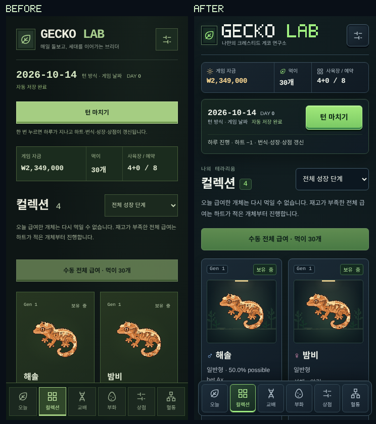
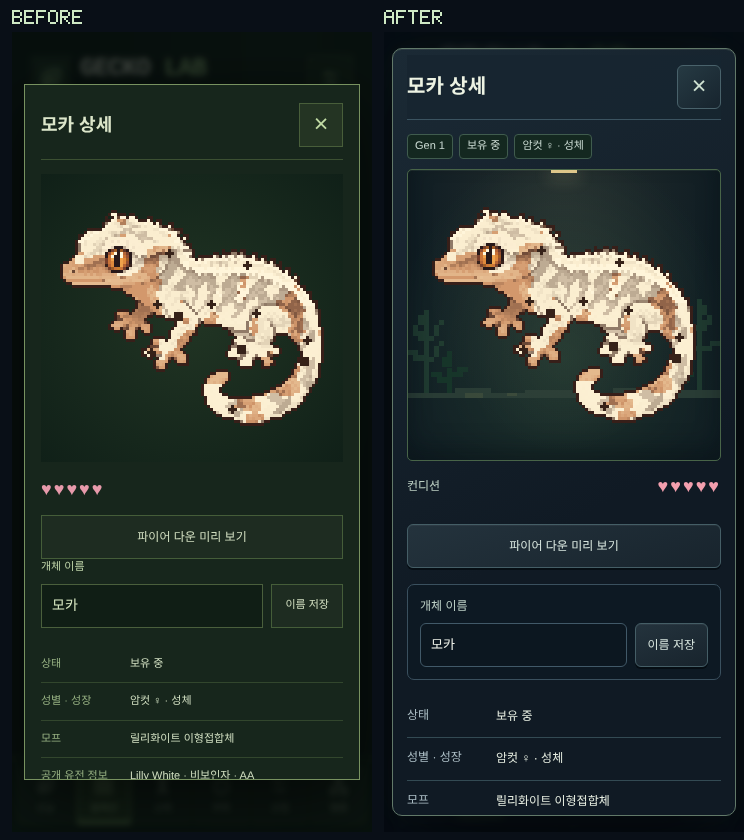
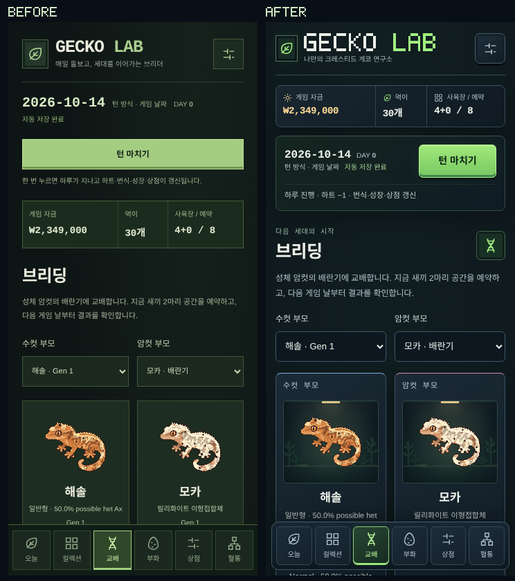
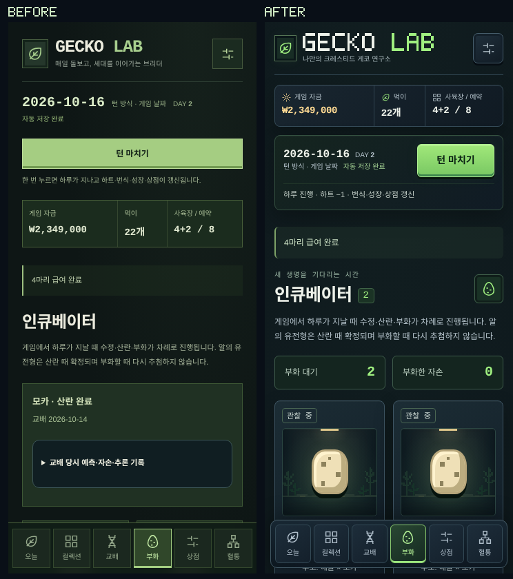

# 테라리움 UI 톤 정리

검토 날짜: **2026-10-14**. 참고 이미지의 분위기·재질·빛·색을 기준으로 정식 게임의 컬렉션, 개체 상세, 브리딩, 인큐베이터를 정리했습니다. 원본 레이아웃이나 가상의 재화를 복제하지 않습니다.

## 실제 모바일 전후 비교

각 이미지 왼쪽은 커밋 `a766db0`의 기존 UI, 오른쪽은 개선 UI입니다. **360×800, 같은 게임 상태와 유전형·개체·자금·날짜**를 사용하는 실제 Chromium 터치 브라우저 캡처입니다. 비교 도표는 두 원본을 1:1로 나란히 놓고 바깥에만 BEFORE/AFTER 표시를 추가합니다.

| 화면 | 전후 비교 | 개선 화면 원본 | 전체 정보 |
| --- | --- | --- | --- |
| 컬렉션 | [비교](ui-tone/collection-comparison.png) | [360×800](ui-tone/after/ui-collection.png) | [스크롤 전체](ui-tone/after/ui-collection-full.png) |
| 개체 상세 | [비교](ui-tone/details-comparison.png) | [360×800](ui-tone/after/ui-details.png) | 동일 모달 안에서 이름·유전 정보·가격·부모·혈통·급여·분양을 스크롤 |
| 브리딩 | [비교](ui-tone/breeding-comparison.png) | [360×800](ui-tone/after/ui-breeding.png) | [예상 확률·경고·일정·도감](ui-tone/after/ui-breeding-full.png) |
| 인큐베이터 | [비교](ui-tone/incubator-comparison.png) | [360×800](ui-tone/after/ui-incubator.png) | [알·부모·교배 이력](ui-tone/after/ui-incubator-full.png) |






## 적용한 톤과 구성

- 어두운 청회색 패널, 녹색 유리·식물 그림자, 작은 따뜻한 조명, 네온 그린 조작부를 사용합니다. 질감은 패널·스프라이트 배경에 두고 본문은 읽기 쉬운 단색으로 유지합니다.
- 로컬 픽셀 워드마크와 식물 실루엣 SVG, 얇은 금속 프레임·안쪽 하이라이트·그림자로 깊이를 줍니다. 외부 폰트나 이미지 API가 필요하지 않습니다.
- 자금·먹이·사육장/예약을 헤더 바로 아래로 모으고 날짜·시간 방식·저장 상태·턴 마치기를 한 패널로 정리합니다. 하루 진행의 하트 −1 비용을 함께 표시합니다.
- 게코 카드에는 테라리움 무대, 세대/보유 상태, **공개 가능한** 성별 표시, 이름·모프·성장·컨디션·평가액·급여를 유지합니다. 새끼의 비공개 성별은 기호로도 드러내지 않습니다.
- 상세 화면은 3배 스프라이트와 컨디션을 먼저 보여주고 이름·공개 유전 정보·부모·가격·혈통·분양을 유지합니다. 모달 닫기 버튼은 스크롤 중에도 보이며 Escape로 닫을 수 있습니다.
- 브리딩의 부모 선택·배란·공개 확률·위험 차단·일정·도감을 유지합니다. 부모 카드의 상단 프레임으로 수컷/암컷을 구분합니다.
- 인큐베이터는 산란한 알/부화한 자손을 먼저 보여주며 번식 이력은 아래에 보존합니다. 산란 전에는 일정과 결과를 먼저 표시합니다. 대기·부화 집계는 기존 알 상태에서 읽습니다.
- 기존 **오늘·컬렉션·교배·부화·상점·혈통 6탭**과 턴/한국 자정 두 방식을 유지합니다. 헤더·버튼·프레임·하단 탭은 같은 재질과 팔레트를 사용합니다.

## 상태와 스프라이트 보존

`src/app/terrarium.css`는 `.hc-shell`에 한정된 테마입니다. 이전 `/lab`, `/lab/breeding` 스타일을 바꾸지 않습니다. UI 마크업의 정리이며 유전학·브리딩·생존·경제·시간·저장 코드와 96×96 렌더러는 수정하지 않습니다. Canvas는 여전히 스무딩 OFF, 1배 카드/3배 상세로 그립니다.

PWA 셸 캐시를 갱신하고 두 로컬 SVG를 설치 때 미리 캐시하며 오프라인 요청에도 반환합니다. 첫 방문 후 인터넷을 끊고 새로고침하는 기존 회귀 검사를 유지합니다. 캐시는 화면을 제공하며 자동 급여나 생존 보호를 하지 않습니다.

비교용 합성 게임은 새 게임 설정으로 자금 **300만원·사육장 8칸**을 지정한 뒤 실제 구매·이름 지정·급여·교배·날짜 진행 함수를 거쳐 만들었습니다. 수정/부화는 기본 **90%/90%**이며, 성공하는 고정 시드를 선택했습니다. 일반 새 게임의 **50만원·4칸** 규칙은 그대로입니다. 컬렉션/상세/브리딩은 DAY 0, 인큐베이터는 DAY 2의 산란된 알 2개 상태입니다.

UI를 읽거나 필터·부모 선택·파이어 미리 보기를 하는 동안 저장 상태가 바뀌지 않는 것을 검사합니다. 부화 때 공개 유전 지식이 갱신되는 기존 동작은 유지하고, 부모의 유전체·유전형·고유 시드를 보존합니다. [원시 보고서](ui-tone/report.json)의 상태 SHA-256으로 전후 게임의 일치를 확인할 수 있습니다. 실제 플레이어의 저장 데이터는 캡처에 사용하지 않았습니다.

## 검증과 재현

```sh
npm run typecheck
npm test
npm run build
PLAYWRIGHT_CHROMIUM_EXECUTABLE_PATH=/usr/bin/chromium npm run test:e2e
node scripts/render-ui-report.mjs
```

`ui-tone.spec.ts`는 네 화면의 실제 모바일/데스크톱 조작, 가로 넘침, 44px 이상 하단 탭, 스무딩 OFF와 비어 있지 않은 스프라이트, 읽기 중 저장 불변, 턴→부화→컬렉션→새끼의 비공개 성별→새로고침을 검사합니다. 전체 Phase 1~6 테스트를 삭제하거나 건너뛰지 않습니다. 최종 결과는 README에 기록합니다.

레퍼런스의 전문 고해상도 UI 아트를 그대로 재현했다고 주장하지 않습니다. 새 배경 장식은 작은 SVG·CSS이며 기존 게코 아트의 품질 한계도 남습니다. 실제 Safari/iOS 기기, 화면 읽기 프로그램의 별도 검증은 아직 수행하지 않았습니다.
